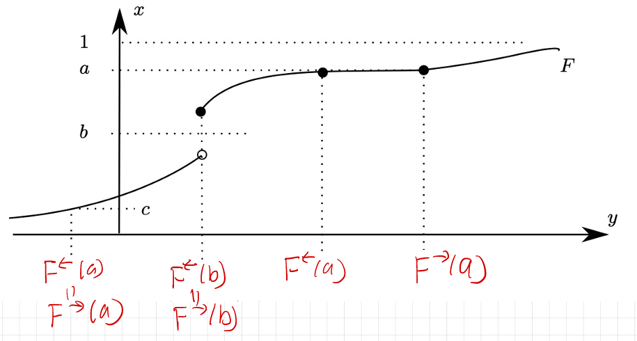

# Lecture 23.3: Skorohod's Theorem

## Introduction & Motivation

For random variables defined on a **common** probability space, almost sure convergence and $L^p$ convergence (for $1 \le p < \infty$, assuming the relevant moments are finite) each imply convergence in probability, which in turn implies **weak convergence** ($\mu_n \Rightarrow \mu$, or $X_n \xrightarrow{d} X$). None of the converse implications holds in general, so weak convergence is the weakest of these modes. Note also that, unlike the other three, weak convergence depends only on the *laws* of the random variables and does not require them to be defined on a common space.

However, there is a fundamental connection back to **almost sure convergence** that serves as a powerful analytical tool in many stochastic contexts.

::: {#thm-skorohod}
## Skorohod's Representation Theorem
Let $(S, d)$ be a separable metric space, and let $\mu_n, \mu \in \text{Prob}(S,\mathcal{B}(S))$. 
If $\mu_n \Rightarrow \mu$ weakly as $n \to \infty$, then there exists a common probability space $(\Omega, \mathcal{F}, P)$ and random variables $Y_n, Y: (\Omega, \mathcal{F}) \to (S, \mathcal{B}(S))$ such that:

1. $Y_{n*} P = \mu_{Y_n} = \mu_n$ for all $n \ge 1$,
2. $Y_{*} P = \mu_Y = \mu$,
3. $Y_n \xrightarrow{a.s.} Y$ as $n \to \infty$.
:::

- Recall that $Y_{n*} P= P \circ Y_n^{-1} = \mu_{Y_n}$ is the **pushforward measure** of $P$ under $Y_n$, which is the same as the **distribution** of $Y_n$. Similarly, $Y_{*} P = \mu_Y$ is the distribution of $Y$.

- **On the hypotheses.** Separability of $(S,d)$ is enough; **completeness is not required**, so we do not need $S$ to be Polish. (It suffices that the limit law $\mu$ have separable support.) Polishness is often assumed in textbook statements only because it supplies convenient tightness and standard-Borel machinery.

- **On the scope of these notes.** @thm-skorohod is quoted here as a standard result in this generality. What we prove below is the case $S = \mathbb{R}$; the general separable case is not proved in this chapter.

::: {#exm-skorohod-normal}
## Skorohod Representation for Converging Normal Distributions

Consider the sequence of probability measures $\mu_n = N\left(\frac{1}{n},1\right)$ for $n\geq 1$ and let $\mu=N(0,1)$. We first observe that $\mu_n\Rightarrow\mu$. Indeed, the CDF of $\mu_n$ is $F_n(x)=\Phi\left(x-\frac{1}{n}\right)$, where $\Phi$ is the CDF of the standard normal distribution. Since $x-\frac{1}{n}\longrightarrow x$ and $\Phi$ is continuous, $F_n(x) = \Phi\left(x-\frac{1}{n}\right) \longrightarrow \Phi(x) = F(x)$ for every $x\in\mathbb{R}$. Hence $\mu_n\Rightarrow\mu$.

Skorohod's Representation Theorem tells us that there exists a common
probability space on which random variables with these distributions can
be constructed so that they converge almost surely. We now construct such random variables explicitly.

#### Step 1: Start with a uniform random variable

Let $(\Omega,\mathcal{F},P)=\bigl((0,1),\mathcal{B}((0,1)),\lambda\bigr)$, where $\lambda$ denotes Lebesgue measure, and define $U(\omega)=\omega$. Then $U\sim\operatorname{Uniform}(0,1)$.

We work on the **open** interval $(0,1)$, not on $[0,1]$. The reason is that $\Phi^{-1}(0)=-\infty$ and $\Phi^{-1}(1)=+\infty$, so on $[0,1]$ the variables defined below would fail to be $\mathbb{R}$-valued at the two endpoints, and the difference $Y_n-Y$ would be the undefined expression $\infty-\infty$ there. On $(0,1)$ every value is finite.

#### Step 2: Transform the uniform random variable

Define $Y=\Phi^{-1}(U)$ and, for each $n\geq1$,  $Y_n=\frac{1}{n}+\Phi^{-1}(U)$. The important feature of this construction is that **the same random variable $U$ is used for every $Y_n$ and for $Y$**.

#### Step 3: Verify the distribution of $Y$

We first show that $Y\sim N(0,1)$. For any $y\in\mathbb{R}$,
$$
\begin{aligned}
P(Y\leq y)
&=
P\left(\Phi^{-1}(U)\leq y\right)\\
&=
P\left(U\leq\Phi(y)\right).
\end{aligned}
$$
The second equality follows because $\Phi$ is a **continuous, strictly increasing bijection** from $\mathbb{R}$ onto $(0,1)$; hence $\Phi^{-1}:(0,1)\to\mathbb{R}$ is well defined and $\Phi^{-1}(u)\leq y\Longleftrightarrow u\leq\Phi(y)$. (Strict increase alone would not suffice; see the warning in the next section.) Since $U\sim\operatorname{Uniform}(0,1)$ and $\Phi(y)\in(0,1)$, $P\left(U\leq\Phi(y)\right)=\Phi(y)$. Therefore, $P(Y\leq y)=\Phi(y)$. Thus the CDF of $Y$ is $\Phi$, so
$Y\sim N(0,1)=\mu$.

#### Step 4: Verify the distribution of $Y_n$

We now show that $Y_n\sim N\left(\frac1n,1\right)=\mu_n$. For any $y\in\mathbb{R}$,
$$
\begin{aligned}
P(Y_n\leq y)
&=
P\left(\frac1n+\Phi^{-1}(U)\leq y\right)\\
&=
P\left(\Phi^{-1}(U)\leq y-\frac1n\right)\\
&=
P\left(U\leq
\Phi\left(y-\frac1n\right)\right)\\
&=
\Phi\left(y-\frac1n\right).
\end{aligned}
$$
But $F_n(y)=\Phi\left(y-\frac1n\right)$ is the CDF of $N(1/n,1)$. Hence
$Y_n\sim N\left(\frac1n,1\right)=\mu_n$. Thus the construction preserves all the required marginal distributions:
$$
P\circ Y_n^{-1}=\mu_n,
\qquad
P\circ Y^{-1}=\mu.
$$

#### Step 5: Verify almost-sure convergence

The construction makes the convergence particularly simple. We have
$$
Y_n-Y
=\left(\frac1n+\Phi^{-1}(U)\right)-\Phi^{-1}(U)
=\frac1n.
$$
Both terms are finite at every $\omega\in\Omega=(0,1)$, so the subtraction is legitimate pointwise. Therefore, for every $\omega\in\Omega$, $|Y_n(\omega)-Y(\omega)|=\frac1n\longrightarrow0$. Hence $Y_n\longrightarrow Y$ *everywhere* on $\Omega$, which is in particular the almost sure convergence asserted by @thm-skorohod. 

:::

::: {.callout-note icon=false}
## Note on the General Metric Space Proof
The proof for a general separable metric space is quite involved. The canonical probability space can be constructed on $\Omega = (0, 1) \times S^{\mathbb{N}}$, with $\mathcal{F} = \mathcal{B}((0, 1) \times S^{\mathbb{N}})$, and $P$ taken to be a suitable **joint coupling measure** (built, for instance, from nested partitions of $S$, or from probability kernels). It is essential that $P$ is in general **not** the product of the marginal laws: a product measure would make the coordinates *independent*, whereas the entire purpose of the construction is to introduce precise dependence between the $Y_n$'s.

In these notes, we present the complete proof for the foundational case where **$S = \mathbb{R}$** by explicitly **inverting the Cumulative Distribution Function (CDF)**.
:::

---

## Inverting the CDF & Generalized Inverses

Suppose $F: \mathbb{R} \to [0, 1]$ is the CDF of a probability measure $\mu \in \text{Prob}\left(\mathbb{R}, \mathcal{B}(\mathbb{R})\right)$, i.e., $F = F_\mu$.

Suppose for a moment that $F$ is **continuous and strictly increasing**. Strict increase means $F(a) < F(b)$ whenever $a<b$, which (since $F(b)-F(a) = \mu((a,b])$) is equivalent to $\mu\left((a,b)\right) > 0$ for all $a<b$. Combined with $\lim_{x\to-\infty}F(x)=0$, $\lim_{x\to+\infty}F(x)=1$ and the intermediate value theorem, continuity and strict increase make $F$ a bijection from $\mathbb{R}$ onto $(0,1)$. We may then set $Y := F^{-1}: (0, 1) \to \mathbb{R}$. Equipping $(0, 1)$ with the Lebesgue measure $\lambda$, the distribution function of $Y$ satisfies:
$$
\begin{aligned}
F_Y(t) &= \lambda\left(Y^{-1}\left((-\infty, t]\right)\right)
= \lambda\left(\left\{ u \in (0,1) : F^{-1}(u) \le t \right\}\right) \\
&= \lambda\left(\left(0, F(t)\right]\right) = F(t),
\end{aligned}
$$
hence $\mu_Y = \mu$.

::: {.callout-warning icon=false}
## Strict increase alone is not enough
Continuity cannot be dropped. A strictly increasing CDF may still have jumps, in which case its range omits an interval and $F^{-1}$ is **not** defined on all of $(0,1)$. For example, take
$$
\mu = \tfrac12 \delta_0 + \tfrac12 N(0,1),
\qquad
F(x) = \tfrac12 \Phi(x) + \tfrac12 \mathbf{1}_{\{x \ge 0\}}.
$$
The normal component forces $\mu\left((a,b)\right)>0$ for all $a<b$, so $F$ is strictly increasing. But $F$ jumps by $\tfrac12$ at $x=0$, and its range omits $\left(\tfrac14,\tfrac34\right)$. Hence $F^{-1}(u)$ is undefined in the ordinary sense for every $u \in \left(\tfrac14,\tfrac34\right)$. This is precisely the defect the generalized inverses below repair.
:::

To handle general CDFs (which may have flat spots or jump discontinuities), we define generalized lower and upper inverses.

::: {#def-cdf-inverses}
## Generalized CDF Inverses
Let $F: \mathbb{R} \to [0, 1]$ be a CDF. For $u \in (0, 1)$, define:

1. **Left-continuous Inverse (Lower Quantile Function)**:
   $$
   F^\leftarrow(u) := \sup \{ x \in \mathbb{R} : F(x) < u \}
   $$
2. **Right-continuous Inverse (Upper Quantile Function)**:
   $$
   F^\rightarrow(u) := \inf \{ x \in \mathbb{R} : F(x) > u \}
   $$
:::

**Finiteness.** Both quantities are *finite real numbers* for every $u \in (0,1)$, so that $F^\leftarrow, F^\rightarrow : (0,1) \to \mathbb{R}$. Indeed, fix $u \in (0,1)$. Since $F(x) \to 0$ as $x \to -\infty$, there is $m$ with $F(m) < u$, so $\{F < u\} \ne \emptyset$. Since $F(x) \to 1$ as $x \to +\infty$, there is $M$ with $F(M) > u$; then $F(x) < u$ forces $x \le M$ by monotonicity, so $\{F<u\}$ is bounded above. Hence $F^\leftarrow(u) = \sup\{F<u\}$ is finite, and a symmetric argument applies to $F^\rightarrow(u) = \inf\{F>u\}$. This is what makes the expression $F\left(F^\leftarrow(u)\right)$ meaningful and makes the quantile transform an $\mathbb{R}$-valued random variable.

:::{#exm-generalized-inverses}
Suppose $P(X=0)=0.3$, $P(X=1)=0.4$, and $P(X=2)=0.3$. Then the CDF is
$$ 
F(y)= 
\begin{cases} 0, & y<0,\\
0.3, & 0\leq y<1,\\ 0.7, & 1\leq y<2,\\ 
1, & y\geq2. 
\end{cases} 
$$
Now take $u=0.5$. We want $F^\leftarrow(0.5) = \sup\{y:F(y)<0.5\}$. Since $F(y)<0.5$ whenever $y<1$, $\{y:F(y)<0.5\}=(-\infty,1)$. Therefore, $F^\leftarrow(0.5) = 1$.

Now consider the upper quantile: $F^\rightarrow(0.5) = \inf\{y:F(y)>0.5\}$. We need to find all $y$ for which $F(y)>0.5$. From the CDF, $F(y)=0.7>0.5$ for $y\ge1$. Therefore,
$\{y:F(y)>0.5\}=[1,\infty)$ and hence $F^\rightarrow(0.5)=1$.

Consider $u=0.7$. Now we see the difference. For the lower quantile,
$F^\leftarrow(0.7) = \sup\{y:F(y)<0.7\}$. Since $F(y)<0.7$ for $y<1$, $F^\leftarrow(0.7)=1$. But for the upper quantile, $F^\rightarrow(0.7) = \inf\{y:F(y)>0.7\}$. At $y=1$, we have $F(1)=0.7$, which is not strictly greater than $0.7$. We therefore have to move to the next jump: $F(y)>0.7 \Longleftrightarrow y\ge2$. Thus, $F^\rightarrow(0.7)=2$. So here
$$ 
F^\leftarrow(0.7)=1, \qquad F^\rightarrow(0.7)=2.
$$

- The lower quantile asks: what is the **supremum** (right endpoint) of the set on which the CDF is strictly below $0.7$? Answer: 1. Observe that this supremum is *not attained*: $\{y:F(y)<0.7\}=(-\infty,1)$ has no largest element. This is exactly why the definition takes a supremum rather than a maximum.
- The upper quantile asks: what is the **infimum** (left endpoint) of the set on which the CDF is strictly greater than $0.7$? Answer: 2. Here the infimum *is* attained, since $\{y:F(y)>0.7\}=[2,\infty)$.
:::

---

## Technical Properties of $F^\leftarrow$ and $F^\rightarrow$

1. **Ordering**:
   $$
   F^\leftarrow(u) \le F^\rightarrow(u), \quad \forall u \in (0, 1).
   $$
   
2. **Equivalence & Flat Spots**: Say that $u$ is the **height of a flat spot** of $F$ if $F \equiv u$ on some nonempty open interval. Then $F^\leftarrow(u) < F^\rightarrow(u)\Longleftrightarrow  u$ is the height of a flat spot of $F$. Consequently, define
   $$
   E := \{u\in(0,1):F^\leftarrow(u)<F^\rightarrow(u)\}.
   $$
For each $u\in E$, the interval $\bigl(F^\leftarrow(u),F^\rightarrow(u)\bigr)$
is a nonempty open interval on which $F$ is constant and equal to $u$.
These intervals are pairwise disjoint. Hence, since every nonempty
open interval in $\mathbb R$ contains a rational number, $E$ is at most
countable. Therefore, $\lambda(E)=0$.

3. **Key Inequality**: For all $u \in (0, 1)$,
   $$
   \lim_{y \uparrow F^\leftarrow(u)} F(y) \le u \le F\left(F^\leftarrow(u)\right)
   $$
   together with the two implications
   * If $y > F^\leftarrow(u)$, then $F(y) \ge u$;
   * If $y < F^\leftarrow(u)$, then $F(y) < u$.

   The two implications and the left-hand inequality use only the definition of the supremum and the monotonicity of $F$. **Right-continuity of $F$ is needed only for the right-hand inequality** $u \le F\left(F^\leftarrow(u)\right)$.

{width=80% #fig-cdf-inverses}

:::{.proof}
## Proof of Technical Properties of $F^\leftarrow$ and $F^\rightarrow$

**Proof of 1**: Fix $u\in(0,1)$ and define $A_u:=\{x\in\mathbb{R}:F(x)<u\}$ and $B_u:=\{x\in\mathbb{R}:F(x)>u\}$. Take any $a\in A_u$ and $b\in B_u$. Then $F(a)<u<F(b)$. Since $F$ is nondecreasing, we must have $a<b$. Otherwise, if $b\leq a$, then $F(b)\leq F(a)$, which contradicts $F(a)<u<F(b)$. Thus every element of $A_u$ is less than every element of $B_u$. Therefore, $\sup A_u\leq\inf B_u$. By the definitions of the lower and upper quantile functions,
$$
F^\leftarrow(u)=\sup A_u\leq\inf B_u=F^\rightarrow(u).
$$
Hence $F^\leftarrow(u)\leq F^\rightarrow(u)$. 

**Proof of 2**: Fix $u\in(0,1)$ and write $a:=F^\leftarrow(u)$ and $b:=F^\rightarrow(u)$.
Suppose first that $a<b$. Take any $x\in(a,b)$. Since $x>a$ and $a=\sup\{y:F(y)<u\}$,
we cannot have $F(x)<u$. Otherwise, $x$ itself would belong to
$\{y:F(y)<u\}$, implying $x\leq a$, which contradicts $x>a$. Similarly, since $x<b$ and $b=\inf\{y:F(y)>u\}$, we cannot have $F(x)>u$. Otherwise, $x$ would belong to $\{y:F(y)>u\}$, implying $b\leq x$,
which contradicts $x<b$. Therefore, $F(x)=u$ for $x\in(a,b)$. Thus $F$ is constant and equal to $u$ on the nonempty open interval $(a,b)$; that is, $u$ is the height of a flat spot of $F$.

Conversely, suppose that $F$ has a flat spot at height $u$. That is, there
exist $a<b$ such that $F(x)=u$ for $x\in(a,b)$. We claim that $\{y:F(y)<u\}\subseteq(-\infty,a]$. Indeed, no $x\in(a,b)$ belongs to this set, since $F(x)=u$; and if $z\geq b$, then monotonicity gives $F(z)\geq F(x)=u$ for any $x\in(a,b)$, so $z$ does not belong to it either. Taking suprema yields $F^\leftarrow(u)\leq a$. Symmetrically, $\{y:F(y)>u\}\subseteq[b,\infty)$, so $F^\rightarrow(u)\geq b$. Hence
$$
F^\leftarrow(u)\leq a<b\leq F^\rightarrow(u).
$$
Therefore, $F^\leftarrow(u)<F^\rightarrow(u)$. This proves $F^\leftarrow(u)<F^\rightarrow(u)\Longleftrightarrow u$ is the height of a flat spot of F.

Now consider
$$
E=\{u\in(0,1):F^\leftarrow(u)<F^\rightarrow(u)\}.
$$
For each $u\in E$, define
$$
I_u:=\bigl(F^\leftarrow(u),F^\rightarrow(u)\bigr).
$$

Each $I_u$ is a nonempty open interval on which $F(x)=u$. Moreover, these intervals are pairwise disjoint. Indeed, suppose that $u,v\in E$ with $u<v$. If $I_u$ and $I_v$ had a common point $x$, then the flat-spot property would give $F(x)=u$
and $F(x)=v$, which is impossible because $u\neq v$. Thus $\{I_u:u\in E\}$ is a collection of pairwise disjoint nonempty open
intervals in $\mathbb R$.

Every nonempty open interval in $\mathbb R$ contains a rational number.
Since the intervals are pairwise disjoint, we can associate a distinct
rational number with each $u\in E$. Because $\mathbb Q$ is countable,
$E$ must be at most countable. Consequently, $\lambda(E)=0$.

**Proof of 3**: Fix $u\in(0,1)$, set $A_u:=\{y\in\mathbb{R}:F(y)<u\}$, and let $q:=F^\leftarrow(u)=\sup A_u$, which is finite by the finiteness remark following @def-cdf-inverses.

*Second implication.* Let $y<q$. By definition of the supremum there exists $z\in A_u$ with $y<z\leq q$. Monotonicity of $F$ then gives
$$
F(y)\leq F(z)<u.
$$
Hence $F(y)<u$ whenever $y<q$. Letting $y\uparrow q$ in this inequality gives
$$
\lim_{y\uparrow q}F(y)\leq u,
$$
which is the left-hand inequality of the display. (The limit exists because $F$ is nondecreasing and bounded.) Note that only monotonicity and the definition of the supremum were used.

*First implication.* Let $y>q$. Since every element of $A_u$ is at most $q$, we have $y\notin A_u$, which by the definition of $A_u$ means exactly $F(y)\geq u$.

*Right-hand inequality.* Apply the first implication along any sequence $y_k\downarrow q$ with $y_k>q$, obtaining $F(y_k)\geq u$ for every $k$. Since $F$ is **right-continuous**,
$$
F(q)=\lim_{k\to\infty}F(y_k)\geq u.
$$
Combining the two inequalities gives
$$
\lim_{y\uparrow F^\leftarrow(u)}F(y)\leq u\leq F\left(F^\leftarrow(u)\right),
$$
as claimed. $\blacksquare$

:::

---

## Construction of the Random Variable

::: {#lem-quantile-transformation}
## Quantile Transformation
Let $\mu \in \text{Prob}\left(\mathbb{R}, \mathcal{B}(\mathbb{R})\right)$ with CDF $F_\mu = F$. Define $Y: (0, 1) \to \mathbb{R}$ by:
$$
Y(u) := F^\leftarrow(u) = \sup \{ y \in \mathbb{R} : F(y) < u \}.
$$
Equip $\left((0, 1), \mathcal{B}((0, 1))\right)$ with the Lebesgue measure $\lambda$. Then $Y$ is a Borel-measurable random variable, and:
$$
Y_* \lambda = \lambda \circ Y^{-1} = \mu_Y = \mu.
$$
:::

:::{.proof}
## Proof of @lem-quantile-transformation
First note that $Y$ is real-valued at every $u \in (0,1)$, by the finiteness remark following @def-cdf-inverses. For any $t \in \mathbb{R}$, we claim the fundamental equivalence:
$$
\{ u \in (0, 1) : Y(u) \le t \} = (0, 1) \cap (0, F(t)].
$$

* $(\subseteq)$: Suppose $Y(u) \le t$. By the right-hand inequality of Property 3, applied at level $u$, we have $u \le F\left(F^\leftarrow(u)\right)$. Since $F^\leftarrow(u) = Y(u) \le t$, monotonicity gives $F\left(F^\leftarrow(u)\right) \le F(t)$. Combining, $u \le F(t)$, so $u \in (0,1) \cap (0, F(t)]$.
* $(\supseteq)$: If $u \le F(t)$, then every $y$ with $F(y) < u$ satisfies $y \le t$: if $y > t$, then non-decreasingness of $F$ gives $F(y) \ge F(t) \ge u$, contradicting $F(y) < u$. Thus $t$ is an upper bound for $\{y : F(y) < u\}$, so $Y(u) = \sup\{y : F(y) < u\} \le t$.

**Measurability.** The displayed identity shows that $\{Y \le t\} \in \mathcal{B}((0,1))$ for every $t \in \mathbb{R}$. Since the sets $\{(-\infty, t] : t \in \mathbb{R}\}$ generate $\mathcal{B}(\mathbb{R})$, it follows that $Y$ is Borel measurable.

**Distribution.** Taking the Lebesgue measure of the above set gives, for every $t \in \mathbb{R}$,
$$
\lambda\left(\{ u \in (0, 1) : Y(u) \le t \}\right) = \lambda\left((0,1) \cap (0, F(t)]\right) = F(t) = F_\mu(t).
$$
The middle equality also covers the degenerate cases: if $F(t) = 0$ the set is empty, and if $F(t) = 1$ it equals $(0,1)$. Since two probability measures on $\mathbb{R}$ with the same CDF coincide, $\mu_Y = \mu$. $\blacksquare$
:::

::: {#cor-inverse-transform-sampling}
## Inverse Transform Sampling
Let $\mu \in \text{Prob}\left(\mathbb{R}, \mathcal{B}(\mathbb{R})\right)$ have CDF $F$, and let $U \sim \text{Unif}(0, 1)$ be defined on some probability space $(\Omega, \mathcal{F}, P)$. Since $P(U \in (0,1)) = 1$, the composition $F^\leftarrow(U)$ is defined almost surely, and
$$
F^\leftarrow(U) \sim \mu.
$$
:::

This is immediate from @lem-quantile-transformation: the law of $U$ is $\lambda$ on $(0,1)$, and pushing forward once more along the Borel map $F^\leftarrow$ gives $\left(F^\leftarrow\right)_* \lambda = \mu$.

:::{.proof}
## Proof of @cor-inverse-transform-sampling
Set $Y=F^\leftarrow(U)$. For any $x\in\mathbb{R}$, the generalized inverse satisfies
$$
F^\leftarrow(u)\leq x
\quad\Longleftrightarrow\quad
u\leq F(x),
\qquad u\in(0,1).
$$
Therefore,
$$
\begin{aligned}
P(Y\leq x)
&=P\left(F^\leftarrow(U)\leq x\right)\\
&=P\left(U\leq F(x)\right).
\end{aligned}
$$
Since $U\sim\operatorname{Unif}(0,1)$ and $F(x)\in[0,1]$, $P\left(U\leq F(x)\right)=F(x)$. Hence, $P(Y\leq x)=F(x)=F_\mu(x)$ for all $x\in\mathbb{R}$. Thus $Y$ and $\mu$ have the same CDF. Therefore, $F_Y=F_\mu$, and consequently $Y\sim\mu$. That is, $F^\leftarrow(U)\sim\mu$.

:::

:::{#exm-illustrating-corollary}
Suppose we want to generate a random variable $X$ with $P(X=1)=0.2$, $P(X=2)=0.5$, $P(X=4)=0.3$. Its CDF is
$$ 
F(x)= 
\begin{cases} 0, & x<1,\\ 
0.2, & 1\le x<2,\\ 
0.7, & 2\le x<4,\\ 
1, & x\ge4. 
\end{cases} 
$$
The generalized inverse is $F^\leftarrow(u)=\sup\{x:F(x)<u\}$. We can determine it interval by interval:
$$ 
F^\leftarrow(u)= 
\begin{cases} 1, & 0<u\le0.2,\\ 
2, & 0.2<u\le0.7,\\ 
4, & 0.7<u<1. 
\end{cases}
$$
Now let $U\sim\operatorname{Unif}(0,1)$ and define $Y=F^\leftarrow(U)$. Then:
$$ 
\begin{aligned}
&P(Y=1) = P(0<U\le0.2) =0.2, \\
&P(Y=2) = P(0.2<U\le0.7) =0.5, \\
&P(Y=4) = P(0.7<U<1) =0.3. 
\end{aligned}
$$
Therefore, $Y\sim\mu$, exactly as the corollary states.

:::

---

## Proof of Skorohod's Theorem ($S = \mathbb{R}$)

:::{.proof}
## Proof of @thm-skorohod for $S = \mathbb{R}$

Let $\mu_n, \mu \in \text{Prob}\left(\mathbb{R}, \mathcal{B}(\mathbb{R})\right)$ with $\mu_n \Rightarrow \mu$. Let $F_n = F_{\mu_n}$ and $F = F_\mu$ be their corresponding CDFs.

Define our probability space as $\Omega = (0, 1)$, $\mathcal{F} = \mathcal{B}((0, 1))$, and $P = \lambda$ (Lebesgue measure).
Define the sequence of random variables:
$$
Y_n(u) := F_n^\leftarrow(u), \quad Y(u) := F^\leftarrow(u), \quad \forall u \in (0, 1).
$$
These are real-valued and Borel measurable by @lem-quantile-transformation, which also gives
$$
\mathcal{L}(Y_n) = \mu_n \quad \forall n \ge 1,
\qquad
\mathcal{L}(Y) = \mu,
$$
establishing conclusions 1 and 2 of @thm-skorohod. To obtain conclusion 3, it suffices to show that $Y_n(u) \to Y(u)$ for every $u \in (0,1) \setminus E$, where
$$
E = \{ t \in (0, 1) : F^\leftarrow(t) < F^\rightarrow(t) \}
$$
is defined in terms of the **limit** CDF $F$ only. By Property 2, $E$ is at most countable, hence $\lambda(E) = 0$, so this yields $Y_n \xrightarrow{a.s.} Y$.

Throughout we use two standard facts. First, since $\mu_n \Rightarrow \mu$ on $\mathbb{R}$, we have $F_n(y) \to F(y)$ at every $y \in \text{Cont}(F)$. Second, $\text{Cont}(F)$ is **dense** in $\mathbb{R}$, because the monotone bounded function $F$ has at most countably many discontinuities.

**Step 1: Lower Bound, $\liminf_{n\to\infty} Y_n(u) \ge Y(u)$.**

Fix $u \in (0,1)$ (this step does not require $u \notin E$). Choose $y \in \text{Cont}(F)$ with $y < Y(u) = F^\leftarrow(u)$; such $y$ exist by density of $\text{Cont}(F)$ and finiteness of $Y(u)$.
By the second implication in Property 3, since $y < F^\leftarrow(u)$, we have $F(y) < u$.

Since $y$ is a continuity point of $F$, we have $F_n(y) \to F(y)$.
Because $F(y) < u$, for all sufficiently large $n$ we have $F_n(y) < u$.
Therefore, by definition of $Y_n(u) = F_n^\leftarrow(u)$, the point $y$ lies in the set whose supremum defines $Y_n(u)$:
$$
Y_n(u) = \sup \{ y' : F_n(y') < u \} \ge y.
$$
Taking the limit inferior as $n \to \infty$ gives:
$$
\liminf_{n \to \infty} Y_n(u) \ge y.
$$
Since this holds for every $y \in \text{Cont}(F)$ with $y < Y(u)$, and such $y$ can be taken with $y \uparrow Y(u)$ by density, we obtain:
$$
\liminf_{n \to \infty} Y_n(u) \ge Y(u).
$$

**Step 2: Upper Bound, $\limsup_{n\to\infty} Y_n(u) \le Y(u)$.**

Now fix $u \in (0,1) \setminus E$ and choose $y \in \text{Cont}(F)$ with $y > Y(u)$.
Since $u \notin E$, we have $Y(u) = F^\leftarrow(u) = F^\rightarrow(u) = \inf \{ y' : F(y') > u \}$. **This is the only place where $u \notin E$ is used.**
Thus $y > F^\rightarrow(u)$. Since the set $\{y': F(y') > u\}$ is closed upward (non-decreasingness of $F$: if $F(z)>u$ and $z'\ge z$ then $F(z')\ge F(z)>u$) and $F^\rightarrow(u)$ is its infimum, any $y > F^\rightarrow(u)$ belongs to the set, i.e.~$F(y) > u$.

Since $y \in \text{Cont}(F)$, $F_n(y) \to F(y) > u$, so for all sufficiently large $n$, $F_n(y) > u$.
Because $F_n$ is non-decreasing, $F_n(y) > u$ makes $y$ an upper bound for $\{z : F_n(z) < u\}$ (any $z > y$ satisfies $F_n(z) \ge F_n(y) > u$), so $Y_n(u) = \sup\{z : F_n(z) < u\} \le y$.
Taking the limit superior as $n \to \infty$ gives:
$$
\limsup_{n \to \infty} Y_n(u) \le y.
$$
Taking $y \downarrow Y(u)$ over continuity points $y \in \text{Cont}(F)$ yields:
$$
\limsup_{n \to \infty} Y_n(u) \le Y(u).
$$

**Conclusion.** Combining both steps:
$$
\lim_{n \to \infty} Y_n(u) = Y(u), \quad \forall u \in (0, 1) \setminus E.
$$
Since $\lambda(E) = 0$, we conclude $Y_n \xrightarrow{a.s.} Y$. $\blacksquare$
:::

---

## Application: The Continuous Mapping Theorem

Skorohod's representation theorem allows us to easily transfer continuous functional properties to weak limit theorems.

::: {#cor-continuous-mapping}
## Continuous Mapping Theorem
Let $f: \mathbb{R} \to \mathbb{R}$ be a Borel-measurable function, and let $X_n$ ($n \ge 1$) and $X$ be real-valued random variables, **not necessarily defined on a common probability space**. Write $\text{Disc}(f)$ for the set of discontinuity points of $f$, and $\mu_X$ for the law of $X$. Suppose
$$
X_n \xrightarrow{d} X
\quad (\text{i.e., } \mu_{X_n} \Rightarrow \mu_X),
\qquad
\mu_X\left(\text{Disc}(f)\right) = 0.
$$

1. **Weak Convergence**: $f(X_n) \xrightarrow{d} f(X)$.
2. **Expectation Limit**: If $f$ is additionally bounded, then $\mathbb{E}[f(X_n)] \to \mathbb{E}[f(X)]$.
:::

**Two remarks on the hypotheses**: 

- First, the condition $\mu_X\left(\text{Disc}(f)\right) = 0$ is meaningful because $\text{Disc}(f)$ is always a Borel set: it is the $F_\sigma$ set $\bigcup_{k \ge 1}\left\{x : \operatorname{osc} f(x) \ge 1/k\right\}$, and each oscillation set is closed. 
- Second, the hypothesis is intrinsic to the *law* of $X$, which is why the $X_n$ and $X$ need not share a probability space. Borel measurability of $f$ ensures that $f(X_n)$ and $f(X)$ are themselves random variables, so that all expectations below are defined.

:::{.proof}
## Proof of @cor-continuous-mapping

**Step 0: Skorohod Coupling**:

Since $X_n \xrightarrow{d} X$, Skorohod's Representation Theorem provides a common probability space $((0, 1), \mathcal{B}(0,1), \lambda)$ and random variables $(Y_n, Y)$ satisfying:
$$
Y_n \overset{d}{=} X_n \quad \forall n, \qquad Y \overset{d}{=} X, \qquad \text{and} \qquad Y_n \xrightarrow{a.s.} Y.
$$
That is, there exists a set $\Omega_1 \subset (0,1)$ with $\lambda(\Omega_1) = 1$ such that $Y_n(\omega) \to Y(\omega)$ for all $\omega \in \Omega_1$.

**Step 1: The Composition $g \circ f$ is Continuous $\lambda$-a.s. at $Y$**:

Let $g \in C_b(\mathbb{R})$ be any bounded continuous test function. Since $g$ is everywhere continuous, any point of continuity of $f$ is also a point of continuity of $g \circ f$:
$$
x \in \text{Cont}(f) \implies g \circ f \text{ is continuous at } x \implies x \notin \text{Disc}(g \circ f).
$$
Taking complements: $\text{Disc}(g \circ f) \subseteq \text{Disc}(f)$. Therefore:
$$
\lambda\left(Y^{-1}\left(\text{Disc}(g \circ f)\right)\right) = \mu_X\left(\text{Disc}(g \circ f)\right) \le \mu_X\left(\text{Disc}(f)\right) = 0,
$$
where the first equality holds because $\mathcal{L}(Y) = \mu_X$.
So there exists $\Omega_2 \subset (0,1)$ with $\lambda(\Omega_2) = 1$ and $Y(\omega) \notin \text{Disc}(g \circ f)$ for all $\omega \in \Omega_2$. Note that $\Omega_2$ depends on the chosen $g$; this is harmless for Part 1, in which $g$ stays fixed throughout Steps 1--5.

**Step 2: Pointwise A.S. Convergence of $g \circ f$**:

The set $\Omega^* := \Omega_1 \cap \Omega_2$ satisfies $\lambda(\Omega^*) = 1$. Fix any $\omega \in \Omega^*$:

- $Y_n(\omega) \to Y(\omega)$ (since $\omega \in \Omega_1$).
- $g \circ f$ is continuous at $Y(\omega)$ (since $\omega \in \Omega_2$).

By the definition of continuity, $y_n \to y$ and $h$ continuous at $y$ implies $h(y_n) \to h(y)$. Applying this with $y_n = Y_n(\omega)$, $y = Y(\omega)$, $h = g \circ f$:
$$(g \circ f)(Y_n(\omega)) \longrightarrow (g \circ f)(Y(\omega)).$$
Since this holds for all $\omega \in \Omega^*$:
$$
(g \circ f)(Y_n) \xrightarrow{a.s.} (g \circ f)(Y).
$$

**Step 3: Dominated Convergence**:

Since $g \in C_b(\mathbb{R})$, there exists $M < \infty$ with $|g(y)| \le M$ for all $y$. Thus:
$$
|(g \circ f)(Y_n(\omega))| \le M \quad \text{for all } n \text{ and all } \omega \in (0,1).
$$
The constant function $M$ is integrable on $((0,1), \lambda)$. By the **Dominated Convergence Theorem**:
$$
\mathbb{E}_\lambda[(g \circ f)(Y_n)] \longrightarrow \mathbb{E}_\lambda[(g \circ f)(Y)].$$

**Step 4: Transfer Back to $(X_n, X)$**:

Since $Y_n \overset{d}{=} X_n$, for any bounded Borel-measurable function $h$:
$$
\mathbb{E}_\lambda[h(Y_n)] = \int_{\mathbb{R}} h \, d\mu_{Y_n} = \int_{\mathbb{R}} h \, d\mu_{X_n} = \mathbb{E}[h(X_n)],
$$
and similarly $\mathbb{E}_\lambda[h(Y)] = \mathbb{E}[h(X)]$. Here $\mathbb{E}_\lambda$ denotes expectation on the coupling space $\left((0,1), \mathcal{B}((0,1)), \lambda\right)$, whereas $\mathbb{E}$ denotes expectation on whichever space carries $X_n$ (respectively $X$); the two are linked only through equality of laws. Applying this with $h = g \circ f$, which is bounded and Borel:
$$
\mathbb{E}[g(f(X_n))] = \mathbb{E}_\lambda[(g \circ f)(Y_n)] \longrightarrow \mathbb{E}_\lambda[(g \circ f)(Y)] = \mathbb{E}[g(f(X))].
$$

**Step 5: Conclusion of Part 1**:

Since $g \in C_b(\mathbb{R})$ was arbitrary and $\mathbb{E}[g(f(X_n))] \to \mathbb{E}[g(f(X))]$ for every such $g$, the definition of weak convergence gives $f(X_n) \xrightarrow{d} f(X)$.

**Step 6: Part 2 — Bounded $f$ Implies $\mathbb{E}[f(X_n)] \to \mathbb{E}[f(X)]$**:

Suppose $|f| \le M$ for some $M < \infty$. We must **not** reuse the set $\Omega^*$ of Step 2: that set was built to make $g \circ f$ continuous at $Y(\omega)$, which does not imply that $f$ itself is continuous there (see the warning below). Instead, define a new full-measure set directly from the hypothesis:
$$
\Omega_f := \Omega_1 \cap \left\{ \omega \in (0,1) : Y(\omega) \notin \text{Disc}(f) \right\}.
$$
Since $\mathcal{L}(Y) = \mu_X$ and $\mu_X\left(\text{Disc}(f)\right) = 0$, the second set has $\lambda$-measure $1$; hence $\lambda(\Omega_f) = 1$.

For every $\omega \in \Omega_f$ we have $Y_n(\omega) \to Y(\omega)$ and $f$ is continuous at $Y(\omega)$, so $f(Y_n(\omega)) \to f(Y(\omega))$. Hence:
$$
f(Y_n) \xrightarrow{a.s.} f(Y).
$$
The uniform bound $|f(Y_n)| \le M$ provides a dominating function, integrable because $\lambda$ is a probability measure, so by DCT:
$$
\mathbb{E}_\lambda[f(Y_n)] \longrightarrow \mathbb{E}_\lambda[f(Y)].
$$
Transferring back via Step 4 (with $h = f$, which is bounded Borel):
$$
\mathbb{E}[f(X_n)] = \mathbb{E}_\lambda[f(Y_n)] \longrightarrow \mathbb{E}_\lambda[f(Y)] = \mathbb{E}[f(X)].
$$
:::

::: {.callout-warning icon=false}
## Why Part 2 needs its own full-measure set
The inclusion established in Step 1 is
$$
\text{Disc}(g \circ f) \subseteq \text{Disc}(f),
$$
and it runs in the **wrong direction** for deducing continuity of $f$ from continuity of $g \circ f$. The inclusion can be strict in the extreme: if $g \equiv c$ is constant, then $g \circ f$ is continuous everywhere, so $\text{Disc}(g \circ f) = \emptyset$ and $\Omega_2 = (0,1)$, no matter how badly discontinuous $f$ may be. Nor can one simply take $g = \text{id}$, since $\text{id} \notin C_b(\mathbb{R})$ — and boundedness of $g$ is exactly what supplied the dominating constant in Step 3. This is why Part 2 is proved using $\Omega_f$, which invokes the hypothesis $\mu_X\left(\text{Disc}(f)\right) = 0$ directly.
:::

:::{#exm-continuous-mapping-theorem}
## Absolute deviation around a threshold
Suppose $X_n\sim N\left(c_n,1\right)$, where $c_n=1+\frac1n$ so that $X_n\xrightarrow{d}X$, where $X\sim N(1,1)$. Consider the function
$$ 
f(x)= 
\begin{cases} 
(x-1)^2, & x\leq 1,\\
2(x-1)^2+1, & x>1. 
\end{cases} 
$$
This function is discontinuous at $x=1$ because
$$ 
\lim_{x\uparrow1}f(x)=0, \qquad \lim_{x\downarrow1}f(x)=1. 
$$
Thus $\operatorname{Disc}(f)=\{1\}$. But the limiting random variable $X\sim N(1,1)$ has a continuous distribution, so $P(X=1)=0$. Consequently, $\mu_X(\operatorname{Disc}(f))=0$. The Continuous Mapping Theorem therefore gives $f(X_n)\xrightarrow{d}f(X)$. 

What does the transformed distribution look like? The transformation is
$$ 
f(X_n) = (X_n-1)^2\mathbf 1\{X_n\leq1\} + \left[2(X_n-1)^2+1\right]\mathbf 1\{X_n>1\}. 
$$
The transformation treats observations differently depending on whether they fall below or above the threshold 1. Nevertheless, $X_n\xrightarrow d X$ is enough to conclude that the entire transformed random variable converges in distribution:
$$
\begin{aligned} 
&(X_n-1)^2\mathbf 1\{X_n\leq1\} + [2(X_n-1)^2+1]\mathbf 1\{X_n>1\} \\
&\xrightarrow d 
(X-1)^2\mathbf 1\{X\leq1\} + [2(X-1)^2+1]\mathbf 1\{X>1\}.
\end{aligned}
$$

:::

---

## Takeaways

**1. The Quantile Construction.** For any CDF $F$ on $\mathbb{R}$, the left-continuous inverse $F^\leftarrow(u) = \sup\{y : F(y) < u\}$ is finite for each $u \in (0,1)$ and defines a Borel map on $\left((0,1),\lambda\right)$ whose pushforward is $\mu$. This is the *inverse transform sampling* principle and is the key building block of the theorem.

**2. Skorohod's Representation Theorem.** If $\mu_n \Rightarrow \mu$ on $\mathbb{R}$, the explicit Skorohod coupling is $Y_n = F_n^\leftarrow$ and $Y = F^\leftarrow$ on the same Lebesgue space $\left((0,1),\lambda\right)$. The a.s. convergence $Y_n \to Y$ is proved by a two-sided squeeze:
- *Lower bound*: for $y < Y(u)$, Property 3 gives $F(y) < u$; weak convergence then forces $F_n(y) < u$ eventually, so $Y_n(u) \ge y$.
- *Upper bound*: for $y > Y(u)$ (using $u \notin E$, so $F^\leftarrow = F^\rightarrow$), the fact that $\{z: F(z)>u\}$ is upward-closed gives $F(y)>u$; weak convergence forces $F_n(y)>u$ eventually, and non-decreasingness of $F_n$ then gives $Y_n(u) \le y$.

Both limiting arguments are legitimate because $\text{Cont}(F)$ is dense in $\mathbb{R}$, a monotone bounded $F$ having at most countably many discontinuities.

**3. Why $u \notin E$ is required.** The set $E = \{u : F^\leftarrow(u) < F^\rightarrow(u)\}$ collects the heights of the flat spots of $F$. The upper bound argument uses $F^\leftarrow(u) = F^\rightarrow(u)$, which fails on $E$; the lower bound argument needs no such restriction. Since flat spots of $F$ correspond to disjoint open intervals in $\mathbb{R}$, $E$ is countable, so $\lambda(E) = 0$ and the a.s. conclusion holds.

**4. The Continuous Mapping Theorem.** Skorohod's theorem reduces CMT to a pointwise statement: since $Y_n \to Y$ a.s. and $g \circ f$ is continuous at $Y(\omega)$ for $\lambda$-a.e. $\omega$ (because $\mathcal{L}(Y) = \mu_X$, $\mu_X(\text{Disc}(f)) = 0$, and $\text{Disc}(g \circ f) \subseteq \text{Disc}(f)$), we get $(g\circ f)(Y_n) \to (g\circ f)(Y)$ a.s., and DCT finishes the argument. For bounded $f$ one argues the same way, but on the set $\Omega_f$ where $f$ *itself* is continuous at $Y(\omega)$: the set built for a fixed test function $g$ will not do, since $\text{Disc}(g \circ f)$ can be much smaller than $\text{Disc}(f)$.

**5. Scope and Limitations.** The explicit CDF-inversion proof is special to $\mathbb{R}$. For a general separable metric space $S$ — completeness is *not* needed — the coupling is obtained by constructing a suitable **joint** measure on an auxiliary space (via nested partitions or probability kernels), not a product of the marginals; the conclusion, and all applications including CMT, remain the same. That general statement is quoted here as a standard result and is **not** proved in this chapter. Importantly, Skorohod's theorem does **not** assert that $X_n \to X$ a.s. on the *original* probability space; it only provides an equivalent coupling on a new space.

---

