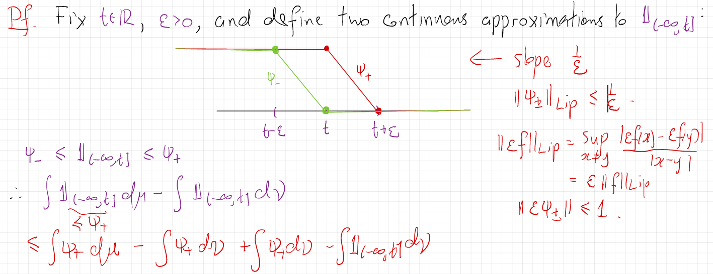

# Lecture 28.1: Metrics on Probability Measures

## Dual Probability Metrics

Let $\mathcal{P}(S, \mathcal{B})$ denote the set of probability measures on a measurable space $(S, \mathcal{B})$. A general class of **(dual) probability metrics** is generated by a family of test functions $\mathcal{H}$ on $S$:
$$
d_{\mathcal{H}}(\mu, \nu) = \sup_{h \in \mathcal{H}} \left| \int_S h \, d\mu - \int_S h \, d\nu \right|.
$$
Assume that every $h\in\mathcal{H}$ is measurable and integrable with respect to every measure under consideration. Then this expression defines a pseudo-metric. It is a genuine metric when $\mathcal{H}$ separates probability measures, meaning that
$$
\int_S h\,d\mu=\int_S h\,d\nu\quad\text{for every }h\in\mathcal{H}
\quad\Longrightarrow\quad \mu=\nu.
$$

In terms of random variables, if $X$ and $Y$ are $S$-valued random variables with laws $\mu$ and $\nu$, respectively, then
$$
\begin{aligned} 
d_{\mathcal{H}}(\mu, \nu) &= \sup_{h \in \mathcal{H}} |\mathbb{E}[h(X)] - \mathbb{E}[h(Y)]|
\end{aligned}
$$

---

## Total Variation Distance ($d_{\text{TV}}$)
The **Total Variation metric** uses bounded measurable functions with supremum norm $\|h\|_\infty \le 1$, where $\|h\|_\infty = \sup_{x \in S} |h(x)|$:
$$
\begin{aligned}
d_{\text{TV}}(\mu, \nu) &= \sup_{B \in \mathcal{B}} |\mu(B) - \nu(B)| \\
&= \frac{1}{2} \sup_{\|h\|_\infty \le 1} \left| \int_S h \, d\mu - \int_S h \, d\nu \right|.
\end{aligned}
$$

- Total variation distance is generally **too strong** to capture weak convergence of probability measures.

If $X$ and $Y$ are $S$-valued random variables with laws $\mu$ and $\nu$, respectively, then
$$
\begin{aligned} 
d_{\text{TV}}(X, Y) &= \sup_{B\in\mathcal{B}} |\mathbb{P}(X \in B) - \mathbb{P}(Y \in B)|\\
&= \frac{1}{2} \sup_{\|h\|_\infty \le 1} |\mathbb{E}[h(X)] - \mathbb{E}[h(Y)]|.
\end{aligned}
$$

## Kolmogorov Metric ($d_{\text{Kol}}$)
Defined on $\mathcal{P}(\mathbb{R}, \mathcal{B}(\mathbb{R}))$, the **Kolmogorov metric** measures the uniform distance between cumulative distribution functions (CDFs):
$$
\begin{aligned} 
d_{\text{Kol}}(\mu, \nu) &= \sup_{t \in \mathbb{R}} |F_\mu(t) - F_\nu(t)| \\
&= \sup_{t \in \mathbb{R}} \left| \int_{\mathbb{R}} \mathbf{1}_{(-\infty, t]} \, d\mu - \int_{\mathbb{R}} \mathbf{1}_{(-\infty, t]} \, d\nu \right|.
\end{aligned}
$$

## Wasserstein $L^1$ Distance ($d_{W_1}$)
Define
$$
\mathcal{P}_1(\mathbb{R})
:=
\left\{\mu\in\mathcal{P}(\mathbb{R},\mathcal{B}(\mathbb{R})):
\int_{\mathbb{R}}|x|\,d\mu(x)<\infty\right\}.
$$
For $\mu,\nu\in\mathcal{P}_1(\mathbb{R})$, the **$1$-Wasserstein distance** uses the class of $1$-Lipschitz functions
$\operatorname{Lip}_1(\mathbb{R})$. Its Lipschitz seminorm is
$$
\|f\|_{\mathrm{Lip}}:=\sup_{x\ne y}\frac{|f(x)-f(y)|}{|x-y|}.
$$
$$
d_{W_1}(\mu, \nu) = \sup_{\|f\|_{\text{Lip}} \le 1} \left| \int_{\mathbb{R}} f \, d\mu - \int_{\mathbb{R}} f \, d\nu \right|.
$$

The $W_1$ topology is stronger than weak convergence. More precisely,
$$
\begin{aligned} 
&d_{W_1}(\mu_n,\mu)\to0\\
&\Longleftrightarrow\quad
\mu_n\Rightarrow\mu
\quad\mathrm{and}\quad
\int_{\mathbb{R}}|x|\,d\mu_n(x)\to\int_{\mathbb{R}}|x|\,d\mu(x).
\end{aligned}
$$

Thus, weak convergence together with convergence of the first absolute moments is exactly what is required for convergence in $W_1$.

There is also a very useful equivalent formulation in terms of random variables. If $X_n\sim\mu_n$ and $X\sim\mu$, then 
$$
d_{W_1}(\mu_n,\mu)\to0 \quad\Longleftrightarrow\quad X_n\Rightarrow X \text{ and } \mathbb E|X_n|\to\mathbb E|X|. 
$$

:::{#exm-weak-vs-wasserstein}
An important subtlety is that weak convergence plus bounded first moments is not sufficient. For example, if
$$ 
X_n= 
\begin{cases} 
n,&\text{with probability }1/n,\\ 
0,&\text{with probability }1-1/n, 
\end{cases} 
$$
Let $F_n$ be the CDF of $X_n$. For any $x$, $F_n(x)=\mathbb P(X_n\leq x)$. Consider the different cases:

1. If $x<0$, then $F_n(x)=0$.
2. If $0\leq x<n$, then the value $0$ is included but $n$ is not, so
$F_n(x)=1-\frac1n$.
3. If $x\geq n$, then both possible values are included, so
$F_n(x)=1$.

Thus, for every fixed $x>0$, once $n>x$, $F_n(x)=1-\frac1n\longrightarrow1$. For $x<0$, $F_n(x)=0$. The CDF of the degenerate random variable $0$ is
$$ 
F(x)= 
\begin{cases} 
0,&x<0,\\ 
1,&x\geq0. 
\end{cases}
$$
Therefore, $F_n(x)\to F(x)$ at every continuity point of $F$, i.e. at every $x\neq0$. Hence, by the CDF characterization of weak convergence, $X_n\Rightarrow0$.

Also, note that $\sup_n\mathbb E|X_n|=1$, but $\mathbb E|X_n|=1\not\to0=\mathbb E|0|$. Hence $d_{W_1}(\mathcal L(X_n),\delta_0)\not\to0$. This is a particularly nice example explaining that why $W_1$ is strictly stronger than weak convergence.
:::

:::{#thm-kantorovich-ruysh}
## Representations of $d_{W_1}$
For $\mu,\nu\in\mathcal{P}_1(\mathbb{R})$, let $F_\mu$ and $F_\nu$ denote their cumulative distribution functions. A **coupling** of $(\mu,\nu)$ is a pair of real-valued random variables $(X,Y)$, defined on a common probability space, such that
$X\sim\mu$ and $Y\sim\nu$. Then

$$
\begin{aligned}
d_{W_1}(\mu,\nu)
&=
\sup_{\|f\|_{\mathrm{Lip}}\leq1}
\left|
\int_{\mathbb{R}}f\,d\mu
-
\int_{\mathbb{R}}f\,d\nu
\right|\\
&=
\int_{-\infty}^{\infty}
|F_\mu(t)-F_\nu(t)|\,dt\\
&=
\inf
\left\{
\mathbb{E}|X-Y|:
(X,Y)\text{ is a coupling of }(\mu,\nu)
\right\}.
\end{aligned}
$$

The first equality is the **dual formulation**, the second is the **CDF representation**, and the third is the **primal (transport) formulation** of the $1$-Wasserstein distance.

:::

:::{#rem-wasserstein-remarks}
$d_{W_1}$ can be viewed from three different perspectives

1. Distributional perspective: $\int_{\mathbb R}|F_\mu(t)-F_\nu(t)|\,dt$. It measures the area between the two CDFs.
2. Functional perspective: $\sup_{\|f\|_{\mathrm{Lip}}\le1} |\mathbb E_\mu[f]-\mathbb E_\nu[f]|$.  It asks: How different can expectations be when tested with functions that cannot change too rapidly?
3. Probabilistic/transport perspective: $\inf_{(X,Y)}\mathbb E|X-Y|$. It asks: What is the smallest possible expected distance between random variables having the two prescribed distributions?

The theorem says these three answers are exactly the same.
:::

---

## Controlling Kolmogorov Distance via Wasserstein Distance
The following theorem provides a bound on the Kolmogorov distance in terms of the Wasserstein distance.

:::{#thm-kolmogorov-wasserstein}
## Kolmogorov–Wasserstein Inequality
Let $\mu,\nu\in\mathcal{P}_1(\mathbb{R})$, and suppose that $\nu$ has a density $\rho$ with respect to Lebesgue measure satisfying $\nu(dx)=\rho(x)dx$ and $0\leq\rho(x)\leq C<\infty$ for Lebesgue-almost every $x$. Recall that the Kolmogorov distance is
$$
d_{\mathrm{Kol}}(\mu,\nu):=\sup_{x\in\mathbb R}|F_\mu(x)-F_\nu(x)|.
$$
Then
$$
d_{\mathrm{Kol}}(\mu,\nu)
\leq 2\sqrt{C\,d_{W_1}(\mu,\nu)}.
$$
:::

:::{#rem-kolmogorov-wasserstein}
The two distances measure different aspects of the discrepancy between $\mu$ and $\nu$:
$d_{\mathrm{Kol}}(\mu,\nu) = \sup_x|F_\mu(x)-F_\nu(x)|$ measures the largest vertical discrepancy between the CDFs, whereas $d_{W_1}(\mu,\nu) = \int_{\mathbb R}|F_\mu(x)-F_\nu(x)|\,dx$ measures the total area between the CDFs.

The theorem says that if $\nu$ has a bounded density, then a small amount of total area forces the maximum vertical discrepancy to be small:
$$ 
\boxed{ d_{W_1}\text{ small} \quad\Longrightarrow\quad d_{\mathrm{Kol}}\text{ small}. } $$
The bounded-density assumption is what makes this possible. It prevents $F_\nu$ from changing arbitrarily rapidly.
:::

:::{.proof}
## Proof of @thm-kolmogorov-wasserstein
Fix $t \in \mathbb{R}$ and $\epsilon > 0$. Construct continuous linear approximations $\psi_-, \psi_+$ to the indicator function $\mathbf{1}_{(-\infty, t]}$:
$$
\psi_- \le \mathbf{1}_{(-\infty, t]} \le \psi_+.
$$
Define
$$
\psi_+(x)=
\begin{cases}
1,&x\le t,\\
\dfrac{t+\epsilon-x}{\epsilon},&t<x<t+\epsilon,\\
0,&x\ge t+\epsilon,
\end{cases}
\qquad
\psi_-(x)=
\begin{cases}
1,&x\le t-\epsilon,\\
\dfrac{t-x}{\epsilon},&t-\epsilon<x<t,\\
0,&x\ge t.
\end{cases}
$$
We can illustrate this construction as follows:

{#fig-indicator}

The slope of $\psi_+$ is $\frac{1}{\epsilon}$, so $\|\psi_+\|_{\text{Lip}} \le \frac{1}{\epsilon}$. Scaling gives $\|\epsilon \psi_+\|_{\text{Lip}} \le 1$.

Bounding the distribution function difference:
$$
\begin{aligned}
\mu((-\infty, t]) - \nu((-\infty, t]) &\le \int \psi_+ \, d\mu - \int \mathbf{1}_{(-\infty, t]} \, d\nu \\
&= \int \psi_+ \, d\mu - \int \psi_+ \, d\nu + \int (\psi_+ - \mathbf{1}_{(-\infty, t]}) \, d\nu \\
&\le \frac{1}{\epsilon} d_{W_1}(\mu, \nu) + \int_{t}^{t+\epsilon} \psi_+(x) \rho(x) \, dx \\
&\le \frac{1}{\epsilon} d_{W_1}(\mu, \nu) + C \epsilon.
\end{aligned}
$$

If $d_{W_1}(\mu,\nu)=0$, then $\mu=\nu$ and the result is immediate. Otherwise, optimizing over $\epsilon>0$ by setting
$$
\epsilon=\sqrt{\frac{d_{W_1}(\mu,\nu)}{C}}
$$
yields:
$$
\mu((-\infty, t]) - \nu((-\infty, t]) \le 2 \sqrt{C \cdot d_{W_1}(\mu, \nu)}.
$$

Applying a symmetric argument with $\psi_-$ for the reverse inequality $\nu((-\infty, t]) - \mu((-\infty, t])$ gives:
$$
d_{\text{Kol}}(\mu, \nu) = \sup_{t \in \mathbb{R}} |\mu((-\infty, t]) - \nu((-\infty, t])| \le 2 \sqrt{C \cdot d_{W_1}(\mu, \nu)}. 
$$
:::

:::{#cor-kolmogorov-wasserstein}
## Standard Normal Comparison
Let $X$ be a real-valued random variable with $\mathbb{E}|X|<\infty$, and let $Z \sim \mathcal{N}(0, 1)$. The density of $Z$ is
$$
\phi(x)=\frac{1}{\sqrt{2\pi}}e^{-x^2/2}\le\frac{1}{\sqrt{2\pi}}<1.
$$
Writing $\mathcal{L}(X)$ and $\mathcal{L}(Z)$ for the corresponding laws, the theorem gives
$$
d_{\text{Kol}}(\mathcal{L}(X),\mathcal{L}(Z))
\le 2\sqrt{d_{W_1}(\mathcal{L}(X),\mathcal{L}(Z))}.
$$
:::

---

## The Berry-Esseen Theorem

The **Berry-Esseen Theorem** provides a quantitative rate of convergence for the Central Limit Theorem under a 3rd moment condition.

:::{#thm-berry-esseen}
## Berry-Esseen Theorem
Let $X_1,X_2,\ldots$ be i.i.d. real-valued random variables defined on a common probability space, with $\mathbb{E}|X_1|^3<\infty$, satisfying:
$$
\mathbb{E}[X_1] = 0, \quad \mathbb{E}[X_1^2] = 1, \quad \text{and} \quad \mathbb{E}[|X_1|^3] = \rho_3 < \infty.
$$

Let $S_n = \sum_{k=1}^n X_k$ and $Z \sim \mathcal{N}(0, 1)$ with CDF $\Phi(t)$. Then there exists a universal constant $C > 0$ such that:
$$
d_{\text{Kol}}\left( \frac{S_n}{\sqrt{n}}, Z \right) = \sup_{t \in \mathbb{R}} \left| F_{S_n/\sqrt{n}}(t) - \Phi(t) \right| \le C \cdot \frac{\rho_3}{\sqrt{n}}.
$$
:::

- The convergence rate $\mathcal{O}(n^{-1/2})$ is optimal in the worst case over distributions satisfying the third-moment assumption.
- The best-known universal upper bound is currently $C < 0.4748$. Known lower bounds show that the optimal universal constant is at least approximately $0.4097$.

## Takeaways

- **TV**: worst-case discrepancy over all measurable sets. It is indeed generally **too strong** for weak convergence.
- **Kolmogorov**: worst-case discrepancy over all half-lines.
$$
d_{\text{Kol}}(\mu_n, \nu) \to 0
\quad\Longrightarrow\quad
\mu_n\Rightarrow\nu.
$$
If $F_\nu$ is continuous, then the converse also holds: weak convergence $\mu_n\Rightarrow\nu$ implies $d_{\text{Kol}}(\mu_n,\nu)\to0$. Without continuity of $F_\nu$, weak convergence need not imply convergence in Kolmogorov distance.
- **Wasserstein**: integrated CDF discrepancy, equivalently discrepancy over Lipschitz functions. On $\mathcal{P}_1(\mathbb{R})$, it metrizes weak convergence together with convergence of first absolute moments.

- Kolmogorov distance can be controlled by Wasserstein distance when the target measure has a bounded density.
$$
d_{\text{Kol}}(\mu, \nu) \le 2 \sqrt{C \cdot d_{W_1}(\mu, \nu)}.
$$
- Berry-Esseen theorem provides a quantitative rate of convergence in the CLT under a 3rd moment condition, with the convergence rate being $\mathcal{O}(n^{-1/2})$ and a universal constant $C$ that has been refined over time.
