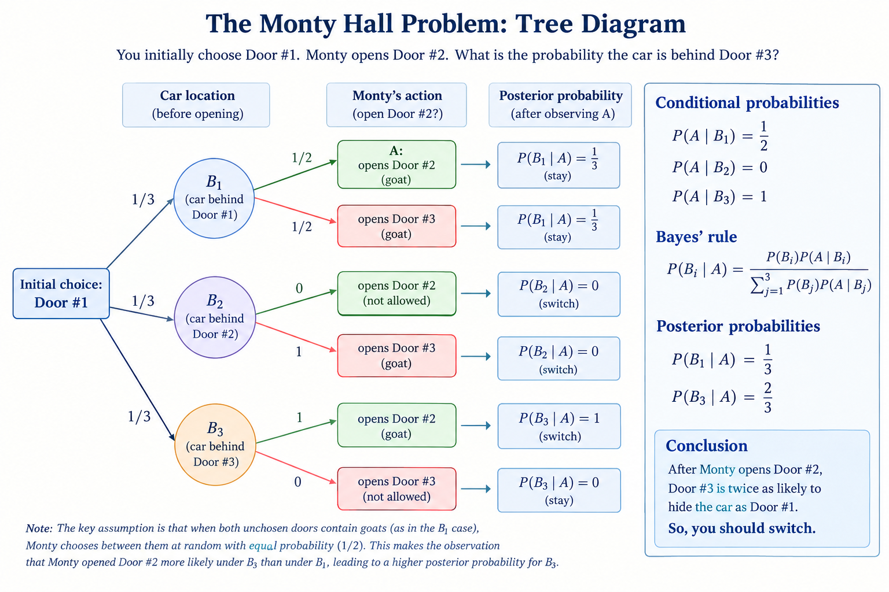

# Lecture 30.1: Conditional Probability

## Foundations of Conditional Probability

Given a underlying probability space $(\Omega, \mathcal{F}, \mathbb{P})$ and an event $B \in \mathcal{F}$ with non-zero probability ($\mathbb{P}(B) > 0$), we can define a updated probability measure $\mathbb{P}_B: \mathcal{F} \to [0, 1]$.

:::{#def-conditional-prob}
### Conditional Probability Measure
For any event $A \in \mathcal{F}$, the conditional probability of $A$ given $B$ is defined as:

$$\mathbb{P}[A \mid B] = \mathbb{P}_B(A) := \frac{\mathbb{P}(A \cap B)}{\mathbb{P}(B)}.$$
:::

* **Prior Probability:** $\mathbb{P}(A)$ represents the baseline probability of event $A$ before observing any auxiliary information.
* **Posterior Probability:** $\mathbb{P}_B(A) = \mathbb{P}[A \mid B]$ represents the updated probability of event $A$ after observing that event $B$ has occurred.

---

## The Law of Total Probability

When the sample space $\Omega$ can be decomposed into mutually exclusive and exhaustive events, we can evaluate global probabilities by combining conditional measures.

:::{#thm-law-total-prob}
### Law of Total Probability (LTP)
Let $\{B_1, B_2, \dots, B_n\}$ be a partition of $\Omega$ such that:

1. $B_i \cap B_j = \emptyset$ for all $i \neq j$,
2. $\bigcup_{j=1}^n B_j = \Omega$,
3. $\mathbb{P}(B_j) > 0$ for all $j = 1, \dots, n$.

Then for any event $A \in \mathcal{F}$:

$$\mathbb{P}(A) = \sum_{j=1}^n \mathbb{P}(A \cap B_j) = \sum_{j=1}^n \mathbb{P}(B_j) \, \mathbb{P}(A \mid B_j).$$
:::

:::{#exm-unfair-coin-collection}
## Unfair Coin Collection

Suppose you find a coin on the street selected from a mixed population:

1. **Fair Coins ($B_1$):** $90\%$ of coins ($\mathbb{P}(B_1) = 0.90$), with $\mathbb{P}(\text{Heads} \mid B_1) = 0.50$.
2. **Biased Coins Type 1 ($B_2$):** $9\%$ of coins ($\mathbb{P}(B_2) = 0.09$), with $\mathbb{P}(\text{Heads} \mid B_2) = 0.60$.
3. **Biased Coins Type 2 ($B_3$):** $1\%$ of coins ($\mathbb{P}(B_3) = 0.01$), with $\mathbb{P}(\text{Heads} \mid B_3) = 0.80$.

What is the overall probability $P(H)$ that a randomly selected coin turns up heads?

Applying the Law of Total Probability:

$$\begin{aligned} \mathbb{P}(H) &= \mathbb{P}(B_1)\mathbb{P}(H \mid B_1) + \mathbb{P}(B_2)\mathbb{P}(H \mid B_2) + \mathbb{P}(B_3)\mathbb{P}(H \mid B_3) \\ &= (0.90)(0.50) + (0.09)(0.60) + (0.01)(0.80) \\ &= 0.450 + 0.054 + 0.008 = 0.512 \quad (51.2\%). \end{aligned}$$
:::

---

## Bayes' Rule and Inversion of Conditioning

Bayes' Rule provides the link between conditional probabilities $\mathbb{P}(A \mid B)$ and $\mathbb{P}(B \mid A)$.

:::{#thm-bayes-rule}
### Bayes' Rule
Let $\{B_1, B_2, \dots, B_n\}$ partition the sample space $\Omega$. For any event $A$ with $\mathbb{P}(A) > 0$, the posterior probability of a specific partition element $B_k$ given $A$ is:

$$\mathbb{P}(B_k \mid A) = \frac{\mathbb{P}(A \cap B_k)}{\mathbb{P}(A)} = \frac{\mathbb{P}(A \mid B_k) \, \mathbb{P}(B_k)}{\sum_{j=1}^n \mathbb{P}(A \mid B_j) \, \mathbb{P}(B_j)}.$$
:::

:::{#exm-coin-bayes}
## Updating the Coin Beliefs

Given that the picked coin comes up heads on a single toss, what is the probability that it is the heavily biased coin ($B_3$)?

$$\mathbb{P}(B_3 \mid H) = \frac{\mathbb{P}(H \mid B_3) \, \mathbb{P}(B_3)}{\mathbb{P}(H)} = \frac{(0.80)(0.01)}{0.512} = \frac{0.008}{0.512} \approx 0.0156. $$

Notice that even though $\mathbb{P}(H \mid B_3) = 80\%$, we have $\mathbb{P}(B_3 \mid H) \neq 80\%$ due to the low prior probability of picking $B_3$.

:::

:::{#exm-demographic-inversion}
## Demographic Inversion (Billionaires)

According to *Forbes* data (April 2019), there are $2208$ billionaires globally, of whom $1964$ are men.

* Let $B$ be the event of being a billionaire, and $M$ be the event of being male.
* $\mathbb{P}(M \mid B) = \frac{1964}{2208} \approx 88.95\%$.
* Crucially, $\mathbb{P}(M \mid B) \neq \mathbb{P}(B \mid M)$, as $\mathbb{P}(B \mid M)$ represents the probability that a randomly chosen male is a billionaire (which is near zero).

:::

---

:::{#exm-epidemiological-fallacy}
## Epidemiological Fallacy (Base Rate Neglect)

Consider a medical diagnostic test for HIV. Let $H$ be the event that an individual has HIV, and $T$ be the event that the test result is positive, with the following specifications:

* **Accuracy:** $99\%$ sensitivity ($\mathbb{P}(T \mid H) = 0.99$) and $99\%$ specificity ($\mathbb{P}(T^c \mid H^c) = 0.99$, implying a false-positive rate $\mathbb{P}(T \mid H^c) = 0.01$).
* **Prevalence (Base Rate):** $0.33\%$ of the population has HIV ($\mathbb{P}(H) = 0.0033$).

If an individual tests positive ($T$), what is the probability that they actually have HIV ($\mathbb{P}(H \mid T)$)?

$$
\begin{aligned} 
\mathbb{P}(H \mid T) &= \frac{\mathbb{P}(T \mid H) \mathbb{P}(H)}{\mathbb{P}(T \mid H)\mathbb{P}(H) + \mathbb{P}(T \mid H^c)\mathbb{P}(H^c)} \\ 
&= \frac{(0.99)(0.0033)}{(0.99)(0.0033) + (0.01)(1 - 0.0033)} \\ 
&= \frac{0.003267}{0.003267 + 0.009967} \\
&= \frac{0.003267}{0.013234} \approx 24.69\%. 
\end{aligned}
$$

Even though the false-positive rate is only $1\%$, the healthy population $H^c$ is so much larger than $H$ ($99.67\%$ vs. $0.33\%$) that false positives outnumber true positives nearly $3$ to $1$. This demonstrates the high sensitivity of posterior probabilities to low prior base rates.

:::

:::{#exm-monty-hall}
## The Monty Hall Problem

In a game show setting with 3 closed doors:

* Behind one door is a valuable prize (a car), while the other two hide nothing of value (goats).
* Let $B_i = \{\text{The car is behind Door } i\}$ for $i \in \{1, 2, 3\}$.
* Prior probabilities before any door is opened:
  $$\mathbb{P}(B_1) = \mathbb{P}(B_2) = \mathbb{P}(B_3) = \frac{1}{3}$$

### Game Setup and Event Definitions

1. **Player Choice:** Without loss of generality, assume you originally choose **Door #1**.
2. **Host Action:** Monty, who knows what is behind all doors, must open one of the two unchosen doors (#2 or #3) to reveal a goat.
3. **Observed Event:** Let $A = \{\text{Monty opens Door \#2}\}$.
4. **Decision:** Should you stick with Door #1 or switch to Door #3?

We evaluate the posterior probability $\mathbb{P}(B_3 \mid A)$ that the car is behind Door #3 given that Monty opened Door #2.

### Host Behavior Conditional Probabilities

To apply Bayes' Rule, we determine $\mathbb{P}(A \mid B_i)$ for each hypothesis $B_i$:

* **Case 1 ($B_1$ is true):** If the car is behind Door #1, both Door #2 and Door #3 hide goats. Monty chooses randomly between them with equal probability:
  $$\mathbb{P}(A \mid B_1) = \frac{1}{2}$$

* **Case 2 ($B_2$ is true):** If the car is behind Door #2, Monty cannot open Door #2 because he must reveal a goat:
  $$\mathbb{P}(A \mid B_2) = 0$$

* **Case 3 ($B_3$ is true):** If the car is behind Door #3, Monty cannot open Door #1 (your choice) or Door #3 (car location). He is forced to open Door #2:
  $$\mathbb{P}(A \mid B_3) = 1$$

### Posterior Calculation via Bayes' Rule

Applying Bayes' Theorem to compute $\mathbb{P}(B_3 \mid A)$:

$$
\begin{aligned}
\mathbb{P}(B_3 \mid A) &= \frac{\mathbb{P}(B_3 \cap A)}{\mathbb{P}(A)}\\
& = \frac{\mathbb{P}(B_3) \mathbb{P}(A \mid B_3)}{\mathbb{P}(B_1)\mathbb{P}(A \mid B_1) + \mathbb{P}(B_2)\mathbb{P}(A \mid B_2) + \mathbb{P}(B_3)\mathbb{P}(A \mid B_3)}
\end{aligned}
$$

Substituting the known probabilities into the formula:

$$
\begin{aligned}
\mathbb{P}(B_3 \mid A) &= \frac{\left(\frac{1}{3}\right) \cdot 1}{\left(\frac{1}{3}\right)\left(\frac{1}{2}\right) + \left(\frac{1}{3}\right)(0) + \left(\frac{1}{3}\right)(1)} \\
&= \frac{\frac{1}{3}}{\frac{1}{6} + 0 + \frac{1}{3}} = \frac{\frac{1}{3}}{\frac{1}{2}} = \frac{2}{3}
\end{aligned}
$$

Similarly, for staying with your original choice:

$$
\mathbb{P}(B_1 \mid A) = \frac{\left(\frac{1}{3}\right)\left(\frac{1}{2}\right)}{\frac{1}{2}} = \frac{\frac{1}{6}}{\frac{1}{2}} = \frac{1}{3}
$$

### Conclusion

Since $\mathbb{P}(B_3 \mid A) = \frac{2}{3}$ and $\mathbb{P}(B_1 \mid A) = \frac{1}{3}$, **you should switch doors**. Switching doubles your chance of winning the car. Monty isn't giving you a new random choice. He is using his knowledge to eliminate a losing door. The $2/3$ probability attached to your initially unchosen set survives his elimination and ends up on the remaining unopened door.

{#fig-monty-hall}

:::