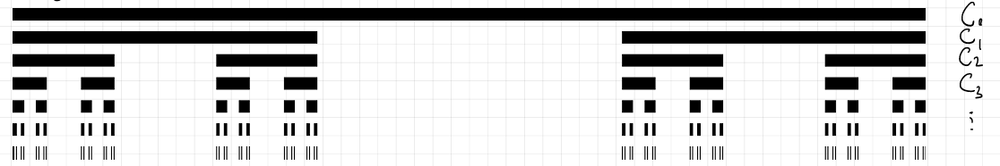

# Lecture 5.1. Radon Measure


## Radon Measures on $\mathbb{R}$

::: {#def-borel-radon-measure}
## Borel and Radon Measures
If $\Omega$ is a topological space, any measure defined on the Borel $\sigma$-algebra $\mathcal{B}(\Omega)$ is called a **Borel measure**. 

A Borel measure $\mu$ on $\mathbb{R}$ is called a **Radon measure** if it assigns finite measure to all bounded intervals:
$$
\mu((a, b]) < \infty \quad \text{for all } -\infty < a < b < \infty.
$${#eq-radon-finite-intervals}

*(More generally, a Radon measure on a Hausdorff topological space is a locally finite Borel measure that is inner regular with respect to compact sets; on $\mathbb{R}$, this simplifies to finiteness on compact sets $\mu(K) < \infty$.)*
:::

## Stieltjes Premeasures and Correspondence

Recall that for any non-decreasing, right-continuous function $F: \mathbb{R} \to \mathbb{R}$, the associated Stieltjes set function $\mu_F((a, b]) = F(b) - F(a)$ defines a premeasure on the algebra of finite disjoint unions of half-open intervals $\mathcal{A}_{\mathbb{R}}$.

The next result shows that every Radon measure on $\mathbb{R}$ arises from a unique (up to an additive constant) Stieltjes premeasure.

::: {#thm-radon-measure-characterization}
## Characterization of Radon Measures on $\mathbb{R}$
If $\mu$ is a Radon measure on $\mathbb{R}$, then there exists a non-decreasing, right-continuous function $F: \mathbb{R} \to \mathbb{R}$ (unique up to an additive constant) such that:
$$
\mu((a, b]) = F(b) - F(a) \quad \text{for all } -\infty < a \le b < \infty.
$${#eq-radon-f-correspondence}
:::

::: {.proof}
## Proof of @thm-radon-measure-characterization

1. **Uniqueness:**
   If $G: \mathbb{R} \to \mathbb{R}$ is another non-decreasing right-continuous function satisfying $\mu((a, b]) = G(b) - G(a)$, then for all $a, b \in \mathbb{R}$:
   $$G(b) - G(a) = F(b) - F(a) \implies G(b) = F(b) + [G(0) - F(0)].$$

   Setting $C = G(0) - F(0)$, we have $G(x) = F(x) + C$, establishing uniqueness up to a constant $C \in \mathbb{R}$.

2. **Existence:**
   Define $F: \mathbb{R} \to \mathbb{R}$ centered at $0$ by:
   $$
   F(x) := 
   \begin{cases}   
    \mu((0, x]), & x \ge 0, \\    
    -\mu((x, 0]), & x < 0.    
    \end{cases}
   $${#eq-f-construction-centered}

   * **Interval Measure Identity:** For any $a < b$, set additive subtraction yields $\mu((a, b]) = F(b) - F(a)$.
   * **Monotonicity:** For $x \le y$, set inclusion $(0, x] \subseteq (0, y]$ (or $(y, 0] \subseteq (x, 0]$ for negative values) together with monotonicity of $\mu$ implies $F(x) \le F(y)$.
   * **Right-Continuity:** Fix $x \in \mathbb{R}$ and let $x_n \downarrow x$ with $x_n > x$. Then $(x, x_1] \setminus (x_n, x_1] = (x, x_n] \downarrow \emptyset$. By continuity of measure from above for finite measure sets:
     $$
     F(x_n) - F(x) = \mu((x, x_n]) \xrightarrow{n \to \infty} 0.
     $$

     Thus, $F(x) = \lim_{n \to \infty} F(x_n)$, proving right-continuity.

:::

---

## Premeasure Continuity Equivalences

::: {#prp-premeasure-continuity-equivalences}
## Equivalences for Premeasures (Driver, Prop. 6.3)
Let $\mu$ be a finitely additive set function on an algebra $\mathcal{A}$. The following conditions are equivalent:

1. $\mu$ is a premeasure (countably additive) on $\mathcal{A}$.
2. **Monotone Increasing Continuity:** If $\{A_n\}_{n=1}^\infty \subseteq \mathcal{A}$ with $A_n \uparrow A \in \mathcal{A}$, then $\mu(A_n) \uparrow \mu(A)$ as $n \to \infty$.

Moreover, if $\mu(\Omega) < \infty$, these are also equivalent to:

3. **Monotone Decreasing Continuity:** If $\{A_n\}_{n=1}^\infty \subseteq \mathcal{A}$ with $A_n \downarrow A \in \mathcal{A}$, then $\mu(A_n) \downarrow \mu(A)$ as $n \to \infty$.
4. **Continuity at Empty Set from Above:** If $\{A_n\}_{n=1}^\infty \subseteq \mathcal{A}$ with $A_n \downarrow \emptyset$, then $\mu(A_n) \downarrow 0$.
:::

::: {.proof}
## Proof of @prp-premeasure-continuity-equivalences 

* **(1) $\Rightarrow$ (2):** Let $A_n \uparrow A \in \mathcal{A}$. Set $B_1 = A_1$ and $B_n = A_n \setminus A_{n-1} \in \mathcal{A}$ for $n \ge 2$. The sequence $\{B_n\}_{n=1}^\infty$ is pairwise disjoint with $\bigcup_{n=1}^\infty B_n = A$ and $\bigcup_{n=1}^N B_n = A_N$. By countable additivity:
  $$
  \mu(A) = \sum_{n=1}^\infty \mu(B_n) = \lim_{N \to \infty} \sum_{n=1}^N \mu(B_n) = \lim_{N \to \infty} \mu(A_N).
  $$


* **(2) $\Rightarrow$ (1):** Let $\{B_n\}_{n=1}^\infty \subseteq \mathcal{A}$ be pairwise disjoint with $\bigcup_{n=1}^\infty B_n = B \in \mathcal{A}$. Define $A_N := \bigcup_{n=1}^N B_n \in \mathcal{A}$. Then $A_N \uparrow B$. Applying (2):
  $$
  \mu(B) = \lim_{N \to \infty} \mu(A_N) = \lim_{N \to \infty} \sum_{n=1}^N \mu(B_n) = \sum_{n=1}^\infty \mu(B_n).
  $$


* **Equivalence of (3)–(4) for Finite Measures:** Follows directly by complementary set subtraction: $\mu(B \setminus A) = \mu(B) - \mu(A)$ whenever $A \subseteq B$ and $\mu(B) < \infty$. 
:::

---

## Cumulative Distribution Functions (CDFs)

::: {#def-borel-cdf}
## Cumulative Distribution Function
Let $\mu$ be a Borel probability measure on $\mathbb{R}$ (so $\mu(\mathbb{R}) = 1$). The **Cumulative Distribution Function (CDF)** of $\mu$ is the function $F_\mu: \mathbb{R} \to [0, 1]$ defined by:
$$
F_\mu(x) := \mu((-\infty, x]).
$${#eq-cdf-def}
:::

::: {#cor-cdf-characterization}
## Characterization of Probability CDFs
A function $F: \mathbb{R} \to \mathbb{R}$ is the CDF of a unique Borel probability measure $\mu$ on $\mathbb{R}$ if and only if it satisfies:

1. **Monotonicity:** $F$ is non-decreasing;
2. **Right-Continuity:** $F(x^+) = \lim_{y \downarrow x} F(y) = F(x)$ for all $x \in \mathbb{R}$;
3. **Asymptotic Limits:**
   $$
   \lim_{x \to -\infty} F(x) = 0 \quad \text{and} \quad \lim_{x \to +\infty} F(x) = 1.
   $${#eq-cdf-limits}
:::

---

## Classification of Borel Probability Measures on $\mathbb{R}$

Every CDF $F$ can be decomposed into three standard types of behavior: Absolutely Continuous, Purely Discrete, and Singular Continuous.

### Absolutely Continuous Measures
A measure $\mu$ is continuous/absolutely continuous if $F_\mu$ is continuous everywhere. In this case, singletons have zero measure:
$$
\mu(\{x_0\}) = \lim_{x \uparrow x_0} \mu((x, x_0]) = \lim_{x \uparrow x_0} (F_\mu(x_0) - F_\mu(x)) = 0.
$${#eq-singleton-zero-measure}

*Example (Uniform Distribution):*
$$
F(x) = \begin{cases}  0, & x \le 0, \\ x, & 0 \le x \le 1, \\ 1, & x \ge 1. \end{cases}
$${#eq-uniform-cdf-example}

In the following, we use Python to visualize the CDF of the uniform distribution on $[0, 1]$.

```{python}
#| fig-cap: "CDF of Uniform Distribution on [0, 1]"
#| label: fig-uniform-cdf
import numpy as np
import matplotlib.pyplot as plt

x = np.linspace(-0.5, 1.5, 500)

F = np.piecewise(
    x,
    [x < 0, (x >= 0) & (x < 1), x >= 1],
    [0, lambda x: x, 1]
)

plt.figure(figsize=(4, 3))
plt.plot(x, F)
plt.xlabel(r'$x$')
plt.ylabel(r'$F(x)$')
#plt.title('CDF of Uniform Distribution on [0, 1]')
plt.grid(True)
plt.show()
```

### Purely Discrete / Point Mass Measures
A measure $\mu$ is purely discrete if its CDF $F_\mu$ is a step function supported on a countable set of point masses $\{x_k\}$.

*Example (Discrete Jump Measure):*
$$
\mu = \frac{1}{3}\delta_0 + \frac{1}{9}\delta_1 + \frac{5}{9}\delta_2.
$${#eq-discrete-measure-example}

Note that the CDF $F_\mu$ is discontinuous at the points $x_0 = 0$, $x_1 = 1$, and $x_2 = 2$, with jump sizes equal to the corresponding point masses:
$$
F_\mu(x) = 
\begin{cases}  
0, & x < 0, \\ 
1/3, & 0 \le x < 1, \\ 
4/9, & 1 \le x < 2, \\ 
1, & x \ge 2. 
\end{cases}
$${#eq-discrete-cdf-jump}

In the following, we use Python to visualize the CDF of this discrete measure.
```{python}
#| fig-cap: "CDF of Discrete Jump Measure"
#| label: fig-discrete-cdf
import numpy as np
import matplotlib.pyplot as plt

# Jump locations and CDF values
x = np.array([-0.5, 0, 1, 2, 2.5])
F = np.array([0, 1/3, 4/9, 1, 1])

plt.figure(figsize=(5, 3.5))

# Horizontal pieces
plt.hlines(0, -0.5, 0, linewidth=1.5)
plt.hlines(1/3, 0, 1, linewidth=1.5)
plt.hlines(4/9, 1, 2, linewidth=1.5)
plt.hlines(1, 2, 2.5, linewidth=1.5)

# Vertical jumps
plt.vlines(0, 0, 1/3, linewidth=1.5)
plt.vlines(1, 1/3, 4/9, linewidth=1.5)
plt.vlines(2, 4/9, 1, linewidth=1.5)

# Filled circles: F(x), showing right-continuity
plt.plot([0, 1, 2], [1/3, 4/9, 1], 'o')

# Open circles: F(x-), showing failure of left-continuity
plt.plot([0, 1, 2], [0, 1/3, 4/9], 'o',
         markerfacecolor='white')

plt.xlabel(r'$x$')
plt.ylabel(r'$F(x)$')
plt.grid(True)
plt.show()
```

### Singular Continuous Measures (The Devil's Staircase / Cantor Measure)
A measure $\mu_{\text{Cantor}}$ can be continuous everywhere ($F$ has no jump discontinuities), yet completely singular with respect to Lebesgue measure ($\mu_{\text{Cantor}}$ is concentrated entirely on a set of Lebesgue measure zero).

*Construction (Cantor Function):*
Let $C_n$ denote the $n$-th stage in the construction of the middle-thirds Cantor set $C = \bigcap_{n=1}^\infty C_n \subset [0, 1]$.


{width=80% #fig-cantor-set}

Define the density functions and sequence of CDFs:
$$
F_n(x) := \int_0^x \left(\frac{3}{2}\right)^n \mathbf{1}_{C_n}(t) \, dt.
$${#eq-cantor-fn-def}

* **Uniform Limit:** $F_n \to F_{\text{Cantor}}$ uniformly on $[0, 1]$.
* **Properties of $F_{\text{Cantor}}$:**
  * $F(0) = 0$ and $F(1) = 1$;
  * $F$ is continuous and non-decreasing;
  * $F'(x) = 0$ almost everywhere with respect to Lebesgue measure (since $F$ is constant on each open interval removed during the Cantor construction);
  * $\mu_{\text{Cantor}}(\{x\}) = 0$ for all $x \in \mathbb{R}$;
  * $\mu_{\text{Cantor}}(C) = 1$, even though $m(C) = 0$ (where $m$ is Lebesgue measure).

---
