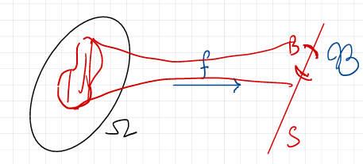
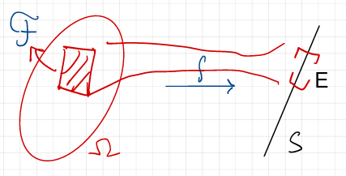

# Lecture 6.2: Measurable Functions

## Preimages vs. Images

Let $f: \Omega \to S$ be a function between two arbitrary sets.

The function $f$ naturally induces two set maps:

1. **Image Map:** $2^\Omega \to 2^S$, defined by $A \mapsto f(A) = \{f(\omega) : \omega \in A\} \subseteq S$.
2. **Preimage Map:** $2^S \to 2^\Omega$, defined by $E \mapsto f^{-1}(E) = \{\omega \in \Omega : f(\omega) \in E\} \subseteq \Omega$.

The image set map is not well-behaved with respect to set operations: one always has $f(A \cap B) \subseteq f(A) \cap f(B)$, but the inclusion may be strict unless $f$ is injective. By contrast, the preimage map $E \mapsto f^{-1}(E)$ preserves all standard set operations: for any family $\{E_\alpha\} \subseteq 2^S$ and any $E \subseteq S$,
$$
\begin{align*}
&f^{-1}\left( \bigcup_\alpha E_\alpha \right) = \bigcup_\alpha f^{-1}(E_\alpha), \\
&f^{-1}\left( \bigcap_\alpha E_\alpha \right) = \bigcap_\alpha f^{-1}(E_\alpha),\\
&f^{-1}(S \setminus E) = \Omega \setminus f^{-1}(E).
\end{align*}
$$

---

## Pull-Back and Push-Forward $\sigma$-Algebras

Pull-back and push-forward $\sigma$-algebras are two fundamental constructions in measure theory that allow us to transfer $\sigma$-algebra structures between different measurable spaces via a function.

::: {#def-pullback-pushforward}
### Pull-Back and Push-Forward $\sigma$-Algebras
Let $(\Omega, \mathcal{F})$ and $(S, \mathcal{B})$ be measurable spaces, and let $f: \Omega \to S$ be a function.

1. The **pull-back** of $\mathcal{B}$ to $\Omega$ by $f$ is:
   $$
   f^* \mathcal{B} := \{ f^{-1}(B) \subseteq \Omega : B \in \mathcal{B} \} \subseteq 2^\Omega.
   $$
2. The **push-forward** of $\mathcal{F}$ to $S$ by $f$ is:
   $$
   f_* \mathcal{F} := \{ E \subseteq S : f^{-1}(E) \in \mathcal{F} \} \subseteq 2^S.
   $$
:::

::: {#prp-pullback-pushforward-sigma}
### Both Constructions Yield $\sigma$-Algebras
In the setting of @def-pullback-pushforward, $f^* \mathcal{B}$ is a $\sigma$-algebra on $\Omega$ and $f_* \mathcal{F}$ is a $\sigma$-algebra on $S$.
:::

::: {.proof}
## Proof of @prp-pullback-pushforward-sigma
Both claims follow from the fact that preimages commute with complements and countable unions.

For $f^* \mathcal{B}$: we have $\Omega = f^{-1}(S) \in f^* \mathcal{B}$; if $A = f^{-1}(B)$ with $B \in \mathcal{B}$, then $\Omega \setminus A = f^{-1}(S \setminus B) \in f^* \mathcal{B}$; and if $A_n = f^{-1}(B_n)$ with $B_n \in \mathcal{B}$, then $\bigcup_{n} A_n = f^{-1}\left( \bigcup_{n} B_n \right) \in f^* \mathcal{B}$.

For $f_* \mathcal{F}$: we have $f^{-1}(S) = \Omega \in \mathcal{F}$, so $S \in f_* \mathcal{F}$; if $f^{-1}(E) \in \mathcal{F}$, then $f^{-1}(S \setminus E) = \Omega \setminus f^{-1}(E) \in \mathcal{F}$; and if $f^{-1}(E_n) \in \mathcal{F}$ for all $n$, then $f^{-1}\left( \bigcup_{n} E_n \right) = \bigcup_{n} f^{-1}(E_n) \in \mathcal{F}$.
:::

**Some Remarks:**

- The pull-back $\sigma$-algebra $f^* \mathcal{B}$ is a $\sigma$-algebra on $\Omega$ formed by taking the preimages of all sets in $\mathcal{B}$. 
- The push-forward $\sigma$-algebra $f_* \mathcal{F}$ is a $\sigma$-algebra on $S$ consisting of all subsets of $S$ whose preimages under $f$ are in $\mathcal{F}$.

::: {#fig-pullback-pushforward layout-ncol=2}
{#fig-pullback}

{#fig-pushforward}

Pull-Back and Push-Forward $\sigma$-Algebras
:::

:::{#exm-pullback-pushforward}
Let $\Omega=\mathbb R$, $\mathcal F=\mathcal B(\mathbb R)$, $S=[0,\infty)$, and $\mathcal B=\mathcal B([0,\infty))$. Define $f:\mathbb{R} \to [0,\infty)$ by $f(x) = x^2$.

Take a Borel set $B\subseteq[0,\infty)$. Its pull-back is
$$ 
f^{-1}(B) = \{x\in\mathbb R:x^2\in B\}. 
$$
For example, take $B=[0,1]$. Then
$$ 
f^{-1}([0,1]) = \{x:x^2\leq1\} = [-1,1]. 
$$
Thus $[-1,1] \in f^* \mathcal{B}$. If $B=(1,4]$, then its pull-back is
$$ 
f^{-1}((1,4]) = \{x:1<x^2\leq4\} = [-2,-1)\cup(1,2]. 
$$
Therefore, $[-2,-1)\cup(1,2] \in f^* \mathcal{B}$.

Now start with $\mathcal F=\mathcal B(\mathbb R)$ and push it forward to $S=[0,\infty)$:
$$ 
f_*\mathcal F = \{E\subseteq[0,\infty): f^{-1}(E)\in\mathcal B(\mathbb R)\}. 
$$
Take any Borel set $E\in\mathcal B([0,\infty))$. Because $f(x)=x^2$ is continuous, $f^{-1}(E)$ is Borel in $\mathbb R$. Therefore, $E\in f_*\mathcal F$. Thus
$$ 
\mathcal B([0,\infty)) \subseteq f_*\mathcal F. 
$$
But in fact we have equality:
$$
f_* \mathcal{B}(\mathbb{R}) = \mathcal{B}([0,\infty)).
$$

:::

More generally, for any collection of subsets $\mathcal{E} \subseteq 2^S$, we can define the pull-back collection:
$$
f^* \mathcal{E} := \{ f^{-1}(E) \subseteq \Omega : E \in \mathcal{E} \} \subseteq 2^\Omega.
$$

::: {#lem-pullback-generation}
### Pull-Back and $\sigma$-Algebra Generation
Let $\Omega$ and $S$ be arbitrary sets, let $f: \Omega \to S$ be an arbitrary map, and let $\mathcal{E} \subseteq 2^S$ be a family of subsets. Then:
$$
\sigma(f^* \mathcal{E}) = f^* \left( \sigma(\mathcal{E}) \right).
$$
No measurability assumption on $f$ is required; this is what makes the lemma applicable *before* measurability is known.
:::

::: {.proof}
## Proof of @lem-pullback-generation
We prove two-way inclusion:

1. **Inclusion $(\subseteq)$:** 
   By @prp-pullback-pushforward-sigma, $f^*(\sigma(\mathcal{E}))$ is a $\sigma$-algebra on $\Omega$. Since $\mathcal{E} \subseteq \sigma(\mathcal{E})$, we have:
   $$
   f^* \mathcal{E} \subseteq f^*(\sigma(\mathcal{E})).
   $$
   Since $\sigma(f^* \mathcal{E})$ is the *smallest* $\sigma$-algebra containing $f^* \mathcal{E}$, it follows that:
   $$
   \sigma(f^* \mathcal{E}) \subseteq f^*(\sigma(\mathcal{E})).
   $$

2. **Inclusion $(\supseteq)$:** 
   Define the set collection:
   $$
   \mathcal{G} := \{ B \in \sigma(\mathcal{E}) : f^{-1}(B) \in \sigma(f^* \mathcal{E}) \}.
   $$
   We show that $\mathcal{G}$ is a $\sigma$-algebra on $S$:
   * $S \in \mathcal{G}$ since $f^{-1}(S) = \Omega \in \sigma(f^* \mathcal{E})$.
   * If $B \in \mathcal{G}$, then $f^{-1}(B^c) = (f^{-1}(B))^c \in \sigma(f^* \mathcal{E})$, so $B^c \in \mathcal{G}$.
   * If $\{B_n\}_{n=1}^\infty \subseteq \mathcal{G}$, then $f^{-1}\left( \bigcup_{n=1}^\infty B_n \right) = \bigcup_{n=1}^\infty f^{-1}(B_n) \in \sigma(f^* \mathcal{E})$, so $\bigcup_{n=1}^\infty B_n \in \mathcal{G}$.

   Moreover $\mathcal{E} \subseteq \mathcal{G}$: for every $E \in \mathcal{E}$ we have $E \in \sigma(\mathcal{E})$, and $f^{-1}(E) \in f^* \mathcal{E} \subseteq \sigma(f^* \mathcal{E})$.

   Thus $\mathcal{G}$ is a $\sigma$-algebra on $S$ containing $\mathcal{E}$. Therefore, by minimality of the generated $\sigma$-algebra, $\sigma(\mathcal{E}) \subseteq \mathcal{G}$, which implies that for every $B \in \sigma(\mathcal{E})$, $f^{-1}(B) \in \sigma(f^* \mathcal{E})$. Consequently:
   $$
   f^*(\sigma(\mathcal{E})) \subseteq \sigma(f^* \mathcal{E}).
   $$
Both inclusions yield equality.
:::

---

## Measurable Functions

::: {#def-measurable-function}
### Measurable Function
Let $(\Omega, \mathcal{F})$ and $(S, \mathcal{B})$ be measurable spaces. A function $f: \Omega \to S$ is $(\mathcal{F}/\mathcal{B})$-**measurable** if:
$$
f^* \mathcal{B} \subseteq \mathcal{F}, \quad \text{i.e., } \forall B \in \mathcal{B}, \; f^{-1}(B) \in \mathcal{F}.
$$
:::

**Some Remarks:**

- A measurable function is one for which the preimage of every measurable set in $S$ is a measurable set in $\Omega$.
- If $f:(\Omega,f^*\mathcal{B})\to (S,\mathcal{B})$ then, by definition, $f$ is measurable. In this sense, the pull-back $\sigma$-algebra $f^*\mathcal{B}$ is the "smallest" $\sigma$-algebra on $\Omega$ that makes $f$ measurable.
- If $f:(\Omega,\mathcal{F})\to (S,f_*\mathcal{F})$ then, by definition, $f$ is measurable. In this sense, the push-forward $\sigma$-algebra $f_*\mathcal{F}$ is the largest $\sigma$-algebra on $S$ with respect to inclusion that makes $f$ measurable: every other such $\sigma$-algebra is contained in $f_*\mathcal{F}$.

::: {#exm-indicator}
**Indicator Functions.**
Let $A \subseteq \Omega$ and consider the indicator function $\mathbf{1}_A: \Omega \to \mathbb{R}$. 
Then $\mathbf{1}_A$ is $(\mathcal{F}/\mathcal{B}(\mathbb{R}))$-measurable if and only if $A \in \mathcal{F}$.

*Proof.* For any $B \in \mathcal{B}(\mathbb{R})$ the preimage $(\mathbf{1}_A)^{-1}(B)$ depends only on $B \cap \{0, 1\}$, and the four resulting cases are exhaustive and mutually exclusive:
$$
(\mathbf{1}_A)^{-1}(B) = \begin{cases}
\Omega & \text{if } 0 \in B \text{ and } 1 \in B, \\
A & \text{if } 1 \in B \text{ and } 0 \notin B, \\
A^c & \text{if } 0 \in B \text{ and } 1 \notin B, \\
\emptyset & \text{if } 0 \notin B \text{ and } 1 \notin B.
\end{cases}
$$
If $A \in \mathcal{F}$, then each of $\Omega, A, A^c, \emptyset$ lies in $\mathcal{F}$, so every preimage is in $\mathcal{F}$ and $\mathbf{1}_A$ is measurable. Conversely, if $\mathbf{1}_A$ is measurable, then taking $B = \{1\} \in \mathcal{B}(\mathbb{R})$ gives $A = (\mathbf{1}_A)^{-1}(\{1\}) \in \mathcal{F}$.
:::

::: {#prp-generating-measurability}
### Criterion for Measurability on Generators
Let $(\Omega, \mathcal{F})$ and $(S, \mathcal{B})$ be measurable spaces, and let $\mathcal{E} \subseteq 2^S$ be a collection of subsets such that $\sigma(\mathcal{E}) = \mathcal{B}$.
A function $f: \Omega \to S$ is $(\mathcal{F}/\mathcal{B})$-measurable if and only if $f^* \mathcal{E} \subseteq \mathcal{F}$.
:::

::: {.proof}
## Proof of @prp-generating-measurability
* ($\Rightarrow$) If $f$ is $(\mathcal{F}/\mathcal{B})$-measurable, then $f^* \mathcal{B} \subseteq \mathcal{F}$. Since $\mathcal{E} \subseteq \mathcal{B}$, it immediately follows that $f^* \mathcal{E} \subseteq \mathcal{F}$.
* ($\Leftarrow$) Assume $f^* \mathcal{E} \subseteq \mathcal{F}$. Since $\mathcal{F}$ is a $\sigma$-algebra containing $f^* \mathcal{E}$, minimality of the generated $\sigma$-algebra gives $\sigma(f^* \mathcal{E}) \subseteq \mathcal{F}$. By @lem-pullback-generation:
  $$
  f^* \mathcal{B} = f^*(\sigma(\mathcal{E})) = \sigma(f^* \mathcal{E}) \subseteq \mathcal{F}.
  $$
  Hence $f$ is $(\mathcal{F}/\mathcal{B})$-measurable.
:::

---

## Real-Valued Measurable Functions and Random Variables

::: {#exm-borel-real-generators}
**Important Characterizations on $\mathbb{R}$.**
A function $X: \Omega \to \mathbb{R}$ is $(\mathcal{F}/\mathcal{B}(\mathbb{R}))$-measurable if and only if any one of the following equivalent conditions holds:

1. $X^{-1}((-\infty, t]) = \{\omega \in \Omega : X(\omega) \le t\} = \{X \le t\} \in \mathcal{F}$ for all $t \in \mathbb{R}$;
2. $X^{-1}((a, b]) = \{a < X \le b\} \in \mathcal{F}$ for all $a, b \in \mathbb{R}$ with $a < b$;
3. $X^{-1}((a, \infty)) = \{X > a\} \in \mathcal{F}$ for all $a \in \mathbb{R}$.

These are equivalent by @prp-generating-measurability, because each of the three displayed collections generates $\mathcal{B}(\mathbb{R})$. For the first two this is @prp-borel-generators. For the third, $(a, \infty) = \mathbb{R} \setminus (-\infty, a]$, so the two collections generate the same $\sigma$-algebra:
$$
\sigma(\{(a, \infty) : a \in \mathbb{R}\}) = \sigma(\{(-\infty, a] : a \in \mathbb{R}\}) = \mathcal{B}(\mathbb{R}).
$$
:::

::: {#def-borel-rv}
### Borel Random Variable
Given a probability space $(\Omega, \mathcal{F}, \mathbb{P})$, a **(Borel) random variable** is an $(\mathcal{F}/\mathcal{B}(\mathbb{R}))$-measurable function $X: \Omega \to \mathbb{R}$.
:::

---

## Compositions and Continuous Functions

::: {#prp-composition-measurable}
### Composition of Measurable Functions
Let $(\Omega, \mathcal{F})$, $(S, \mathcal{B})$, and $(T, \mathcal{C})$ be measurable spaces. If $f: \Omega \to S$ is $(\mathcal{F}/\mathcal{B})$-measurable and $g: S \to T$ is $(\mathcal{B}/\mathcal{C})$-measurable, then the composition $g \circ f: \Omega \to T$ is $(\mathcal{F}/\mathcal{C})$-measurable.
:::

::: {.proof}
## Proof of @prp-composition-measurable
For any $C \in \mathcal{C}$, using the preimage composition property:
$$
(g \circ f)^{-1}(C) = f^{-1}(g^{-1}(C)).
$$
Since $g$ is $(\mathcal{B}/\mathcal{C})$-measurable, $g^{-1}(C) \in \mathcal{B}$. Since $f$ is $(\mathcal{F}/\mathcal{B})$-measurable, $f^{-1}(g^{-1}(C)) \in \mathcal{F}$. Thus $(g \circ f)^{-1}(C) \in \mathcal{F}$.
:::

::: {#cor-continuous-transformations}
### Continuous Transformations of Random Variables
Let $X_1, X_2, \dots, X_d$ be random variables on $(\Omega, \mathcal{F}, \mathbb{P})$.
If $f: \mathbb{R}^d \to \mathbb{R}$ is Borel measurable (in particular, if it is continuous), then $Y = f(X_1, \dots, X_d)$ is a random variable.

*(Examples: $X_1 + X_2$, $X_1 X_2$, $\max(X_1, X_2)$, etc.)*
:::

::: {.proof}
## Proof of @cor-continuous-transformations
If $f$ is assumed Borel measurable, its $(\mathcal{B}(\mathbb{R}^d)/\mathcal{B}(\mathbb{R}))$-measurability is part of the hypothesis. If $f$ is continuous, then $f^{-1}((-\infty, t])$ is closed, because $(-\infty, t]$ is closed, and closed sets are Borel; since $\{(-\infty, t] : t \in \mathbb{R}\}$ generates $\mathcal{B}(\mathbb{R})$ by @prp-borel-generators, @prp-generating-measurability shows that $f$ is $(\mathcal{B}(\mathbb{R}^d)/\mathcal{B}(\mathbb{R}))$-measurable.

Define the joint map $\mathbf{X} = (X_1, \dots, X_d): \Omega \to \mathbb{R}^d$ and let
$$
\mathcal{E} := \left\{ \prod_{j=1}^d (a_j, b_j) \;:\; a_j, b_j \in \mathbb{Q}, \; a_j < b_j \right\}
$$
be the countable collection of open boxes with rational vertices. Exactly as in @prp-borel-generators, $\mathcal{E}$ is a base for the topology of $\mathbb{R}^d$: every open $U \subseteq \mathbb{R}^d$ is the union of those members of $\mathcal{E}$ contained in $U$, and that union is countable because $\mathcal{E}$ is countable. Hence $\mathcal{B}(\mathbb{R}^d) \subseteq \sigma(\mathcal{E})$, and since every box is open the reverse inclusion also holds, so $\sigma(\mathcal{E}) = \mathcal{B}(\mathbb{R}^d)$.

Each $X_j$ is $(\mathcal{F}/\mathcal{B}(\mathbb{R}))$-measurable, so for every box in $\mathcal{E}$,
$$
\mathbf{X}^{-1}\left( \prod_{j=1}^d (a_j, b_j) \right) = \bigcap_{j=1}^d X_j^{-1}((a_j, b_j)) \in \mathcal{F},
$$
being a finite intersection of sets in $\mathcal{F}$. By @prp-generating-measurability, $\mathbf{X}$ is $(\mathcal{F}/\mathcal{B}(\mathbb{R}^d))$-measurable.
Since $Y = f \circ \mathbf{X}$, by @prp-composition-measurable, $Y$ is $(\mathcal{F}/\mathcal{B}(\mathbb{R}))$-measurable, so $Y$ is a random variable.
:::

---

## Information and Push-Forward Distributions

In the "background" (inaccessible) probability space $(\Omega, \mathcal{F}, \mathbb{P})$, we observe random variables $X_1, X_2, \dots, X_d$. What is actually knowable?

Two primary structures emerge:

### Current Information ($\sigma$-Algebra Generated by Random Variables)

::: {#def-generated-sigma}
### Generated $\sigma$-Algebra
The $\sigma$-algebra generated by a collection of random variables $\{X_j\}_{j=1}^d$ on $(\Omega, \mathcal{F}, \mathbb{P})$ is:
$$
\sigma(X_1, \dots, X_d) := \sigma\left( \bigcup_{j=1}^d X_j^* \mathcal{B}(\mathbb{R}) \right) \subseteq \mathcal{F},
$$
where the inclusion holds because each $X_j$ is $(\mathcal{F}/\mathcal{B}(\mathbb{R}))$-measurable, so that $\bigcup_{j=1}^d X_j^* \mathcal{B}(\mathbb{R}) \subseteq \mathcal{F}$.

This is the **smallest $\sigma$-algebra** on $\Omega$ with respect to which $X_1, \dots, X_d$ are all measurable: a $\sigma$-algebra $\mathcal{G}$ on $\Omega$ makes every $X_j$ measurable if and only if $X_j^* \mathcal{B}(\mathbb{R}) \subseteq \mathcal{G}$ for each $j$, i.e. if and only if $\mathcal{G} \supseteq \bigcup_{j=1}^d X_j^* \mathcal{B}(\mathbb{R})$, and the smallest such $\sigma$-algebra is by definition the one generated by that union.
:::

**Equivalent and very useful characterizations**:

$$
\begin{align*}
\sigma(X_1, \dots, X_d) &= \sigma\left(\bigcup_{j=1}^d \{X^{-1}_j(B): B \in \mathcal{B}(\mathbb{R})\}\right)\\
&=  \sigma\left(\{X^{-1}_j(B): B \in \mathcal{B}(\mathbb{R}), j = 1, \dots, d\}\right)\\
&=\sigma\left(\bigcup_{j=1}^d \{X^{-1}_j((-\infty, t]): t \in \mathbb{R}\}\right)\\
&=\sigma\left(\bigcup_{j=1}^d \{\{X_j \le t\}: t \in \mathbb{R}\}\right).
\end{align*}
$$

The first two lines merely rewrite the same collection of sets. The passage to the third line is not a rewriting and uses @lem-pullback-generation. Put $\mathcal{E} := \{(-\infty, t] : t \in \mathbb{R}\}$, $\mathcal{A} := \bigcup_{j=1}^d X_j^* \mathcal{E}$ and $\mathcal{C} := \bigcup_{j=1}^d X_j^* \mathcal{B}(\mathbb{R})$. Since $\mathcal{A} \subseteq \mathcal{C}$, we get $\sigma(\mathcal{A}) \subseteq \sigma(\mathcal{C})$. Conversely, for each $j$,
$$
X_j^* \mathcal{B}(\mathbb{R}) = X_j^*\left( \sigma(\mathcal{E}) \right) = \sigma\left( X_j^* \mathcal{E} \right) \subseteq \sigma(\mathcal{A}),
$$
using $\sigma(\mathcal{E}) = \mathcal{B}(\mathbb{R})$ from @prp-borel-generators and @lem-pullback-generation for the middle equality. Hence $\mathcal{C} \subseteq \sigma(\mathcal{A})$, so $\sigma(\mathcal{C}) \subseteq \sigma(\mathcal{A})$ and the two $\sigma$-algebras agree.

Note that the outer $\sigma(\cdot)$ cannot be dropped: $\bigcup_{j=1}^d \sigma\left( X_j^* \mathcal{E} \right)$ is in general **not** a $\sigma$-algebra.

---

### Push-Forward Measure (Distribution)
The next natural question is: what is the probability distribution of the random vector $(X_1, \dots, X_d)$? This is captured by the **push-forward measure**. It is the probability measure on $\mathbb{R}^d$ induced by the random vector $(X_1, \dots, X_d)$.

::: {#prp-pushforward-measure}
### Push-Forward Probability Measure
If $(\Omega, \mathcal{F}, \mathbb{P})$ is a probability space and $f: \Omega \to S$ is $(\mathcal{F}/\mathcal{B})$-measurable, then $f^{-1}(B) \in \mathcal{F}$ for every $B \in \mathcal{B}$, and the map $\mu_f: \mathcal{B} \to [0, 1]$ defined by:
$$
\mu_f(B) := (f_*\mathbb{P})(B) = \mathbb{P}(f^{-1}(B)) = \mathbb{P}(\{f \in B\})
$$
is a probability measure on $(S, \mathcal{B})$ (also written as $\mathbb{P} \circ f^{-1}$). The notation $f_*\mathbb{P}$ distinguishes this push-forward measure from the pull-back operation $f^*$ on sets.
:::

::: {.proof}
## Proof of @prp-pushforward-measure
We verify the axioms of a probability measure. Note first that $\mu_f$ is well defined and non-negative: $f^{-1}(B) \in \mathcal{F}$ for every $B \in \mathcal{B}$ by measurability, and $\mathbb{P} \ge 0$.

1. **Null empty set:**
   $$
   \mu_f(\emptyset) = \mathbb{P}(f^{-1}(\emptyset)) = \mathbb{P}(\emptyset) = 0.
   $$
2. **Normalization:**
   $$
   \mu_f(S) = \mathbb{P}(f^{-1}(S)) = \mathbb{P}(\Omega) = 1.
   $$
3. **Countable Additivity:**
   Let $\{B_n\}_{n=1}^\infty \subseteq \mathcal{B}$ be a sequence of pairwise disjoint measurable sets. Since preimages preserve disjoint unions:
   $$
   f^{-1}\left( \bigcup_{n=1}^\infty B_n \right) = \bigcup_{n=1}^\infty f^{-1}(B_n), \quad \text{with } f^{-1}(B_i) \cap f^{-1}(B_j) = \emptyset \text{ for } i \neq j.
   $$
   By the countable additivity of $\mathbb{P}$:
   $$
   \mu_f\left( \bigcup_{n=1}^\infty B_n \right) = \mathbb{P}\left( \bigcup_{n=1}^\infty f^{-1}(B_n) \right) = \sum_{n=1}^\infty \mathbb{P}(f^{-1}(B_n)) = \sum_{n=1}^\infty \mu_f(B_n).
   $$
:::

::: {#rem-vector-law}
### The Law of a Random Vector
Taking $(S, \mathcal{B}) = (\mathbb{R}^d, \mathcal{B}(\mathbb{R}^d))$ and $f = \mathbf{X} = (X_1, \dots, X_d)$, which is $(\mathcal{F}/\mathcal{B}(\mathbb{R}^d))$-measurable by the proof of @cor-continuous-transformations, @prp-pushforward-measure yields the **joint law** $\mu_{\mathbf{X}} = \mathbf{X}_* \mathbb{P}$ of the random vector. It is a probability measure on $(\mathbb{R}^d, \mathcal{B}(\mathbb{R}^d))$ with
$$
\mu_{\mathbf{X}}(B) = \mathbb{P}\left( (X_1, \dots, X_d) \in B \right), \qquad B \in \mathcal{B}(\mathbb{R}^d).
$$
:::

::: {#rem-rv-pushforward-special-case}
### Special Case for Real Random Variables
When $(S, \mathcal{B}) = (\mathbb{R}, \mathcal{B}(\mathbb{R}))$ and $f = X$ is a real random variable, $\mu_X = \mathbb{P} \circ X^{-1}$ is the **law/distribution** of $X$, and $\mu_X(B) = \mathbb{P}(X \in B)$.

The **cumulative distribution function** (CDF) of $X$ is defined by $F_X(t) := \mathbb{P}(X \le t)$ for $t \in \mathbb{R}$. Evaluating the law on the rays $(-\infty, t]$ recovers it:
$$
\mu_X((-\infty, t]) = \mathbb{P}(X \le t) = F_X(t).
$$
:::

---

