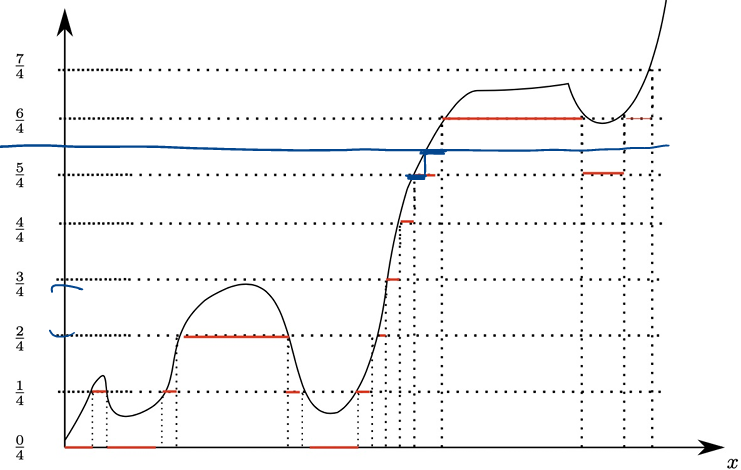

# Lecture 7.1: Robustness and Measurability

## Robustness of Measurability

## Continuous and Discontinuous Transformations

We showed previously that if $f: \mathbb{R}^d \to \mathbb{R}$ is $(\mathcal{B}(\mathbb{R}^d) / \mathcal{B}(\mathbb{R}))$-measurable and $X_1, \dots, X_d$ are $(\mathcal{F}/\mathcal{B}(\mathbb{R}))$-measurable random variables on $(\Omega, \mathcal{F}, \mathbb{P})$, then $Y = f(X_1, \dots, X_d)$ is $(\mathcal{F}/\mathcal{B}(\mathbb{R}))$-measurable.

This property applies in particular to continuous functions $f: \mathbb{R}^d \to \mathbb{R}$.

::: {#exm-max-min-abs}
### Continuous Transformations: Maximum, Minimum, and Absolute Value
The maps $(x, y) \mapsto \max(x, y) = x \vee y=\frac{x+y+|x-y|}{2}$ and $(x, y) \mapsto \min(x, y) = x \wedge y=\frac{x+y-|x-y|}{2}$ are continuous on $\mathbb{R}^2$ and thus Borel measurable.

For any real random variable $X$, we define its positive and negative parts by:
$$
X_+ := \max(X, 0) = X \vee 0, \quad X_- := -\min(X, 0) = (-X) \vee 0.
$$
Then 

- $X_+$ and $X_-$ are measurable random variables. 
- Consequently, $X = X_+ - X_-$ and $|X| = X_+ + X_-$ are measurable, and 
- $X$ is measurable if and only if both $X_+$ and $X_-$ are measurable.
:::

The general result for $(\mathcal{B}(\mathbb{R}^d)/\mathcal{B}(\mathbb{R}))$-measurable maps is also useful when dealing with discontinuous functions of random variables.

::: {#exm-reciprocal-map}
### The Generalized Reciprocal Map
For any fixed parameter $\alpha \in \mathbb{R}$, define the modified inversion function $i_\alpha: \mathbb{R} \to \mathbb{R}$ by:
$$
i_\alpha(x) := \begin{cases} \frac{1}{x} & \text{if } x \neq 0, \\ \alpha & \text{if } x = 0. \end{cases}
$$

To verify that $i_\alpha$ is $(\mathcal{B}(\mathbb{R})/\mathcal{B}(\mathbb{R}))$-measurable, consider first $\alpha = 0$. For any $x > 0$:
$$
i_0^{-1}((x, \infty)) = \left(0, \frac{1}{x}\right) \in \mathcal{B}(\mathbb{R}),
$$
and for any $x < 0$:
$$
i_0^{-1}((x, \infty)) = [0, \infty) \cup \left(-\infty, \frac{1}{x}\right) \in \mathcal{B}(\mathbb{R}).
$$
Thus $i_0$ is Borel measurable. In general, for any $\alpha \in \mathbb{R}$, we can decompose $i_\alpha$ as:
$$
i_\alpha(x) = i_0(x) \mathbf{1}_{\mathbb{R} \setminus \{0\}}(x) + \alpha \mathbf{1}_{\{0\}}(x),
$$
which is a sum and product of Borel measurable functions and is therefore Borel measurable.

Consequently, if $f: \Omega \to \mathbb{R}$ is $(\mathcal{F}/\mathcal{B}(\mathbb{R}))$-measurable, then the function $(i_\alpha \circ f): \Omega \to \mathbb{R}$ given by:
$$
(i_\alpha \circ f)(\omega) = \begin{cases} \frac{1}{f(\omega)} & \text{if } f(\omega) \neq 0, \\ \alpha & \text{if } f(\omega) = 0 \end{cases}
$$
is also $(\mathcal{F}/\mathcal{B}(\mathbb{R}))$-measurable.
:::

---

## Measurability Under Pointwise Limits

Let $\overline{\mathbb{R}} = [-\infty, \infty]$ denote the extended real numbers equipped with its Borel $\sigma$-algebra $\mathcal{B}(\overline{\mathbb{R}})$.

::: {#prp-limits-measurable}
### Measurability of Limits and Extrema
Let $f_n: (\Omega, \mathcal{F}) \to (\overline{\mathbb{R}}, \mathcal{B}(\overline{\mathbb{R}}))$ be a sequence of measurable functions for $n \in \mathbb{N}$. Then the following functions are also $(\mathcal{F}/\mathcal{B}(\overline{\mathbb{R}}))$-measurable:
$$
\sup_{n \ge 1} f_n, \quad \inf_{n \ge 1} f_n, \quad \limsup_{n \to \infty} f_n, \quad \liminf_{n \to \infty} f_n.
$$
*(Note: An analogous closure property under pointwise limits is false in general for continuous functions $C(\mathbb{R})$.)*
:::

::: {.proof}
## Proof of @prp-limits-measurable
We evaluate the preimages under generators of $\mathcal{B}(\overline{\mathbb{R}})$:

1. **Supremum:** For any $t \in \mathbb{R}$:
   $$
   \begin{align*}
   \left( \sup_{n \ge 1} f_n \right)^{-1}([-\infty, t]) &= \left\{ \omega \in \Omega : \sup_{n \ge 1} f_n(\omega) \le t \right\} \\
   &= \left\{ \omega \in \Omega : f_n(\omega) \le t \text{ for all } n \ge 1 \right\}.
   \end{align*}
   $$
   This yields the countable intersection:
   $$
   \bigcap_{n=1}^\infty \{ \omega \in \Omega : f_n(\omega) \le t \} = \bigcap_{n=1}^\infty f_n^{-1}([-\infty, t]) \in \mathcal{F}.
   $$

2. **Infimum:** Using $\inf_{n} f_n = -\sup_{n} (-f_n)$ (or directly observing $\{ \inf_n f_n \ge t \} = \bigcap_n \{ f_n \ge t \}$), $\inf_n f_n$ is measurable.

3. **Limit Superior and Inferior:** By definition of limit superior and limit inferior:
   $$
   \limsup_{n \to \infty} f_n = \inf_{n \ge 1} \left( \sup_{j \ge n} f_j \right), \quad \liminf_{n \to \infty} f_n = \sup_{n \ge 1} \left( \inf_{j \ge n} f_j \right).
   $$
   Since $g_n = \sup_{j \ge n} f_j$ is measurable for each $n$, its infimum $\inf_{n \ge 1} g_n = \limsup_{n \to \infty} f_n$ is measurable. Similarly, $\liminf_{n \to \infty} f_n$ is measurable.

If $f(\omega) = \lim_{n \to \infty} f_n(\omega)$ exists pointwise, then $f = \limsup_{n \to \infty} f_n = \liminf_{n \to \infty} f_n$, so $f$ is measurable.
:::

---

## Simple Functions and Approximations

::: {#def-simple-function}
### Simple Function
A function $\varphi: \Omega \to \mathbb{R}$ is called a **simple function** if its range $\varphi(\Omega) \subseteq \mathbb{R}$ is a finite set.
:::

::: {#exm-simple-representation}
### Canonical Representation of Simple Functions
Let $\varphi(\Omega) = \{\alpha_1, \alpha_2, \dots, \alpha_n\}$ be the distinct values taken by $\varphi$. Define $A_j := \varphi^{-1}(\{\alpha_j\}) \subseteq \Omega$ for $j = 1, \dots, n$. 

The sets $A_1, \dots, A_n$ form a finite partition of $\Omega$ (i.e., they are pairwise disjoint and $\bigcup_{j=1}^n A_j = \Omega$). The function $\varphi$ can be written uniquely in canonical form as:
$$
\varphi(\omega) = \sum_{j=1}^n \alpha_j \mathbf{1}_{A_j}(\omega).
$$
Special case: For a single indicator function $\varphi = \alpha \mathbf{1}_A$, $\varphi$ is $(\mathcal{F}/\mathcal{B}(\mathbb{R}))$-measurable if and only if $A \in \mathcal{F}$.
:::

::: {#lem-simple-measurability}
### Measurability Criterion for Simple Functions
A simple function $\varphi = \sum_{j=1}^n \alpha_j \mathbf{1}_{A_j}$ with distinct non-zero values $\{\alpha_j\}_{j=1}^n$ is $(\mathcal{F}/\mathcal{B}(\mathbb{R}))$-measurable if and only if $A_j = \varphi^{-1}(\{\alpha_j\}) \in \mathcal{F}$ for every $j = 1, \dots, n$.
:::

---

## Simple Approximation Theorem

::: {#thm-simple-approximation}
### Simple Approximation Theorem
If $f: (\Omega, \mathcal{F}) \to (\mathbb{R}, \mathcal{B}(\mathbb{R}))$ is measurable, then there exists a sequence of simple measurable functions $\{\varphi_n\}_{n=1}^\infty$ such that:
$$
\lim_{n \to \infty} \varphi_n(\omega) = f(\omega) \quad \text{for all } \omega \in \Omega.
$$
Moreover:

1. If $f \ge 0$, the sequence can be chosen to be non-decreasing ($0 \le \varphi_1 \le \varphi_2 \le \dots \le f$).
2. If $f$ is bounded on $M \subseteq \Omega$, then $\varphi_n \to f$ uniformly on $M$.
:::

{width=80% #fig-simple-function}

::: {.proof}
## Proof of @thm-simple-approximation
It suffices to prove the result for $f \ge 0$; for a general real-valued function $f$, we apply the construction separately to $f_+$ and $f_-$, setting $\varphi_n = \varphi_n^+ - \varphi_n^-$.

Assume $f \ge 0$. For each $n \in \mathbb{N}$, partition $[0, 2^n]$ into $2^{2n}$ dyadic intervals of length $2^{-n}$, and define:
$$
\varphi_n(\omega) := \sum_{k=0}^{2^{2n}-1} \frac{k}{2^n} \mathbf{1}_{\left\{ \frac{k}{2^n} < f \le \frac{k+1}{2^n} \right\}}(\omega) + 2^n \mathbf{1}_{\{f > 2^n\}}(\omega).
$$
Equivalently,
$$
\varphi_n(\omega) = 
\begin{cases}
\frac{k}{2^n} & \text{if } \frac{k}{2^n} < f(\omega) \le \frac{k+1}{2^n}, \quad k = 0, 1, \dots, 2^{2n}-1, \\
2^n & \text{if } f(\omega) > 2^n.
\end{cases}
$$
Thus $\varphi_n$ is essentially obtained by rounding $f$ down to the nearest multiple of $2^{-n}$, while truncating values above $2^n$. The function $\varphi_n$ takes only finitely many values:
$$
0, 2^{-n}, 2 \cdot 2^{-n}, \dots, (2^{2n}-1) \cdot 2^{-n}, 2^n.
$$

1. **Measurability:** Each set $\left\{ \omega \in \Omega : \frac{k}{2^n} < f(\omega) \le \frac{k+1}{2^n} \right\} = f^{-1}\left( \left(\frac{k}{2^n}, \frac{k+1}{2^n}\right] \right) \in \mathcal{F}$ and $\{f > 2^n\} = f^{-1}((2^n, \infty)) \in \mathcal{F}$ by measurability of $f$. Thus $\varphi_n$ is a simple measurable function.
2. **Monotonicity:** By construction, refining from $n$ to $n+1$ splits each interval of length $2^{-n}$ into two sub-intervals of length $2^{-(n+1)}$, yielding $\varphi_n \le \varphi_{n+1} \le f$.
3. **Convergence:** For any $\omega \in \Omega$, choose $N \in \mathbb{N}$ large enough such that $f(\omega) \le 2^N$. Then for all $n \ge N$:
   $$
   0 \le f(\omega) - \varphi_n(\omega) \le 2^{-n}.
   $$
   Taking $n \to \infty$ gives pointwise convergence $\varphi_n(\omega) \to f(\omega)$. If $f$ is bounded on $M$, $N$ can be chosen independently of $\omega$, yielding uniform convergence on $M$.
:::

---

## Factoring Random Variables (Doob–Dynkin Lemma)

## Characterization of Generated $\sigma$-Algebras

::: {#def-generated-sigma}
### Generated $\sigma$-Algebra
The $\sigma$-algebra generated by a collection of random variables $\{X_j\}_{j=1}^d$ is:
$$
\sigma(X_1, \dots, X_d) := \sigma\left( \bigcup_{j=1}^d X_j^* \mathcal{B}(\mathbb{R}) \right) \subseteq \mathcal{F}.
$$
This is the **smallest $\sigma$-algebra** on $\Omega$ with respect to which $X_1, \dots, X_d$ are all measurable.
:::

**Equivalent and very useful characterizations**:

$$
\begin{align*}
\sigma(X_1, \dots, X_d) &= \sigma\left(\bigcup_{j=1}^d \{X^{-1}_j(B): B \in \mathcal{B}(\mathbb{R})\}\right)\\
&=  \sigma\left(\{X^{-1}_j(B): B \in \mathcal{B}(\mathbb{R}), j = 1, \dots, d\}\right)\\
&=\sigma\left(\bigcup_{j=1}^d \{X^{-1}_j((-\infty, t]): t \in \mathbb{R}\}\right)\\
&=\sigma\left(\bigcup_{j=1}^d \{X_j \le t\}: t \in \mathbb{R}\right).
\end{align*}
$$

Let $\mathbf{X} = (X_1, \dots, X_d)^T : \Omega \to \mathbb{R}^d$ be a random vector formed by $(\mathcal{F}/\mathcal{B}(\mathbb{R}))$-measurable random variables $X_1, \dots, X_d$.

::: {#lem-generated-sigma-vector}
### Structure of $\sigma(X_1, \dots, X_d)$
Let $\mathbf{X}: \Omega \to \mathbb{R}^d$ be defined by $\mathbf{X}(\omega) = (X_1(\omega), \dots, X_d(\omega))^T$. Then:
$$
\sigma(X_1, \dots, X_d) = \mathbf{X}^* \mathcal{B}(\mathbb{R}^d) = \{ \mathbf{X}^{-1}(B) \subseteq \Omega : B \in \mathcal{B}(\mathbb{R}^d) \}.
$$
This is the smallest $\sigma$-algebra on $\Omega$ with respect to which $X_1, \dots, X_d$ are measurable.
:::

::: {.proof}
## Proof of @lem-generated-sigma-vector
To establish the equality $\sigma(X_1, \dots, X_d) = \mathbf{X}^* \mathcal{B}(\mathbb{R}^d)$, we show inclusion in both directions.

### Step 1: Proof that $\sigma(X_1, \dots, X_d) \subseteq \mathbf{X}^* \mathcal{B}(\mathbb{R}^d)$

Recall that the individual generated $\sigma$-algebra is defined as:
$$
\sigma(X_1, \dots, X_d) = \sigma\left( \bigcup_{i=1}^d \{ X_i^{-1}(A) : A \in \mathcal{B}(\mathbb{R}) \} \right).
$$

For each coordinate index $i \in \{1, \dots, d\}$, consider the coordinate projection map $\pi_i : \mathbb{R}^d \to \mathbb{R}$ defined by $\pi_i(x_1, \dots, x_d) = x_i$. 

1. **Measurability of $\pi_i$:** The projection map $\pi_i$ is continuous under the standard Euclidean topology, which implies it is $(\mathcal{B}(\mathbb{R}^d)/\mathcal{B}(\mathbb{R}))$-measurable.
2. **Composition:** Notice that $X_i = \pi_i \circ \mathbf{X}$. For any Borel set $A \in \mathcal{B}(\mathbb{R})$, taking preimages gives:
   $$
   X_i^{-1}(A) = (\pi_i \circ \mathbf{X})^{-1}(A) = \mathbf{X}^{-1}\left( \pi_i^{-1}(A) \right).
   $$
3. **Inclusion of Generators:** Since $\pi_i$ is measurable, $\pi_i^{-1}(A) \in \mathcal{B}(\mathbb{R}^d)$. Thus, by definition of the pull-back $\sigma$-algebra:
   $$
   X_i^{-1}(A) \in \mathbf{X}^* \mathcal{B}(\mathbb{R}^d) \quad \forall A \in \mathcal{B}(\mathbb{R}), \; \forall i \in \{1, \dots, d\}.
   $$

Because $\mathbf{X}^* \mathcal{B}(\mathbb{R}^d)$ is a valid $\sigma$-algebra on $\Omega$ that contains all generator sets of $\sigma(X_1, \dots, X_d)$, the minimal property of generated $\sigma$-algebras implies:
$$
\sigma(X_1, \dots, X_d) \subseteq \mathbf{X}^* \mathcal{B}(\mathbb{R}^d).
$$

---

### Step 2: Proof that $\mathbf{X}^* \mathcal{B}(\mathbb{R}^d) \subseteq \sigma(X_1, \dots, X_d)$

Consider the collection of open hyper-rectangles in $\mathbb{R}^d$:
$$
\mathcal{C} = \left\{ \prod_{i=1}^d (a_i, b_i) \subset \mathbb{R}^d : a_i, b_i \in \mathbb{R}, \; a_i < b_i \right\}.
$$
It is a standard result of measure theory that $\mathcal{C}$ generates the $d$-dimensional Borel $\sigma$-algebra, i.e., $\mathcal{B}(\mathbb{R}^d) = \sigma(\mathcal{C})$.

1. **Preimages of Generators:** Take any open rectangle $I = \prod_{i=1}^d (a_i, b_i) \in \mathcal{C}$. Using the properties of preimages:
   $$
   \begin{align*}
   \mathbf{X}^{-1}(I) &= \mathbf{X}^{-1}\left( \bigcap_{i=1}^d \pi_i^{-1}((a_i, b_i)) \right)\\
   & = \bigcap_{i=1}^d \mathbf{X}^{-1}\left( \pi_i^{-1}((a_i, b_i)) \right)\\
   & = \bigcap_{i=1}^d X_i^{-1}((a_i, b_i)).
   \end{align*}
   $$
   Since $X_i^{-1}((a_i, b_i)) \in \sigma(X_i) \subseteq \sigma(X_1, \dots, X_d)$ for each $i$, and $\sigma$-algebras are closed under finite intersections, we have:
   $$
   \mathbf{X}^{-1}(I) \in \sigma(X_1, \dots, X_d) \quad \forall I \in \mathcal{C}.
   $$

2. **Good Sets Argument:** Define the collection of sets in $\mathbb{R}^d$ whose preimage under $\mathbf{X}$ is measurable with respect to $\sigma(X_1, \dots, X_d)$:
   $$
   \mathcal{M} = \left\{ B \in \mathcal{B}(\mathbb{R}^d) : \mathbf{X}^{-1}(B) \in \sigma(X_1, \dots, X_d) \right\}.
   $$
   We verify that $\mathcal{M}$ forms a $\sigma$-algebra on $\mathbb{R}^d$:
   * **Entire space:** $\mathbf{X}^{-1}(\mathbb{R}^d) = \Omega \in \sigma(X_1, \dots, X_d)$, so $\mathbb{R}^d \in \mathcal{M}$.
   * **Complements:** If $B \in \mathcal{M}$, then $\mathbf{X}^{-1}(B^c) = (\mathbf{X}^{-1}(B))^c \in \sigma(X_1, \dots, X_d)$ because $\sigma$-algebras are closed under complementation. Thus $B^c \in \mathcal{M}$.
   * **Countable Unions:** If $(B_n)_{n=1}^\infty \subseteq \mathcal{M}$, then $\mathbf{X}^{-1}\left(\bigcup_{n=1}^\infty B_n\right) = \bigcup_{n=1}^\infty \mathbf{X}^{-1}(B_n) \in \sigma(X_1, \dots, X_d)$ by countable closure. Thus $\bigcup_{n=1}^\infty B_n \in \mathcal{M}$.

3. **Conclusion:** Since $\mathcal{M}$ is a $\sigma$-algebra on $\mathbb{R}^d$ and contains $\mathcal{C}$, it must contain the $\sigma$-algebra generated by $\mathcal{C}$:
   $$
   \mathcal{B}(\mathbb{R}^d) = \sigma(\mathcal{C}) \subseteq \mathcal{M}.
   $$
   By definition of $\mathcal{M}$, this implies that for every $B \in \mathcal{B}(\mathbb{R}^d)$, $\mathbf{X}^{-1}(B) \in \sigma(X_1, \dots, X_d)$, which proves:
   $$
   \mathbf{X}^* \mathcal{B}(\mathbb{R}^d) \subseteq \sigma(X_1, \dots, X_d).
   $$

Combining Step 1 and Step 2 yields $\sigma(X_1, \dots, X_d) = \mathbf{X}^* \mathcal{B}(\mathbb{R}^d)$, completing the proof.
:::

---

## The Doob–Dynkin Representation Theorem

::: {#thm-doob-dynkin}
### Doob–Dynkin Representation Theorem
Let $X_1, \dots, X_d$ be $(\mathcal{F}/\mathcal{B}(\mathbb{R}))$-measurable random variables, and let $\mathbf{X} = (X_1, \dots, X_d): \Omega \to \mathbb{R}^d$.

A random variable $Y: \Omega \to \mathbb{R}$ is $(\sigma(X_1, \dots, X_d) / \mathcal{B}(\mathbb{R}))$-measurable if and only if there exists a Borel measurable function $f: \mathbb{R}^d \to \mathbb{R}$ such that:
$$
Y = f(X_1, \dots, X_d) = f \circ \mathbf{X}.
$$
:::

::: {.proof}
## Proof of @thm-doob-dynkin
* ($\Leftarrow$) Assume that $Y = f \circ \mathbf{X}$ with $f$ Borel measurable. Recall that $\mathbf{X}$ is $\mathcal{F}/\mathcal{B}(\mathbb{R}^d)$-measurable. Indeed, since each $X_j$ is measurable, the vector-valued map $\mathbf{X}$ is measurable. Therefore, by composition of measurable functions,  $Y=f \circ \mathbf{X}$ is $\mathcal{F}/\mathcal {B}(\mathbb{R})$-measurable. More importantly, for every $B\in\mathcal{B}(\mathbb{R})$,
$$ 
Y^{-1}(B) = (f\circ\mathbf{X})^{-1}(B) = \mathbf{X}^{-1}\bigl(f^{-1}(B)\bigr). 
$$
Since $f$ is Borel measurable, $f^{-1}(B)\in\mathcal{B}(\mathbb{R}^d)$. Hence
$$
Y^{-1}(B) \in \{\mathbf{X}^{-1}(A): A \in \mathcal{B}(\mathbb{R}^d)\} 
= \sigma(\mathbf{X}).
$$
Thus $Y:\bigl(\Omega,\sigma(\mathbf X)\bigr) \to \bigl(\mathbb R,\mathcal B(\mathbb R)\bigr)$ is measurable. Therefore, $Y$ is $\sigma(X_1,\ldots,X_d)/\mathcal{B}(\mathbb{R})$-measurable.
	​

* ($\Rightarrow$) We prove existence of $f$ via standard machine induction on the structure of $Y$:

  **Step 1: Indicator Functions.**
  Suppose $Y = \mathbf{1}_A$ for some $A \in \sigma(X_1, \dots, X_d)$. By @lem-generated-sigma-vector, $A = \mathbf{X}^{-1}(B)$ for some $B \in \mathcal{B}(\mathbb{R}^d)$. Define $f = \mathbf{1}_B: \mathbb{R}^d \to \mathbb{R}$, which is Borel measurable. Then:
  $$
  f(\mathbf{X}(\omega)) = \mathbf{1}_B(\mathbf{X}(\omega)) = \mathbf{1}_{\mathbf{X}^{-1}(B)}(\omega) = \mathbf{1}_A(\omega) = Y(\omega).
  $$
  Therefore $Y=f\circ\mathbf X$. Thus, the result holds for indicator functions.

  **Step 2: Simple Functions.**
  Suppose $Y = \sum_{j=1}^n \alpha_j \mathbf{1}_{A_j}$ is simple and $(\sigma(\mathbf{X})/\mathcal{B}(\mathbb{R}))$-measurable. Then $A_j \in \sigma(\mathbf{X})$ for each $j$, so $A_j = \mathbf{X}^{-1}(B_j)$ for some $B_j \in \mathcal{B}(\mathbb{R}^d)$. Define $f = \sum_{j=1}^n \alpha_j \mathbf{1}_{B_j}$, which is Borel measurable. Then:
  $$
  f \circ \mathbf{X} = \sum_{j=1}^n \alpha_j \mathbf{1}_{B_j} \circ \mathbf{X} = \sum_{j=1}^n \alpha_j \mathbf{1}_{\mathbf{X}^{-1}(B_j)} = \sum_{j=1}^n \alpha_j \mathbf{1}_{A_j} = Y.
  $$
  Thus the result holds for simple measurable functions.

  **Step 3: General Measurable Functions.**
  Let $Y$ be an arbitrary $(\sigma(\mathbf{X})/\mathcal{B}(\mathbb{R}))$-measurable random variable. By @thm-simple-approximation, there exists a sequence of simple $\sigma(\mathbf{X})$-measurable functions $\{Y_n\}_{n=1}^\infty$ such that $Y_n(\omega) \to Y(\omega)$ pointwise for all $\omega \in \Omega$.

  By Step 2, for each $n \in \mathbb{N}$, there exists a Borel measurable function $g_n: \mathbb{R}^d \to \mathbb{R}$ such that $Y_n = g_n \circ \mathbf{X}$.
  Define $f: \mathbb{R}^d \to \mathbb{R}$ by:
  $$
  f(x) := \limsup_{n \to \infty} g_n(x).
  $$
  By @prp-limits-measurable, $f$ is Borel measurable. Moreover, for every $\omega \in \Omega$:
  $$
  f(\mathbf{X}(\omega)) = \limsup_{n \to \infty} g_n(\mathbf{X}(\omega)) = \limsup_{n \to \infty} Y_n(\omega) = \lim_{n \to \infty} Y_n(\omega) = Y(\omega).
  $$
  Hence $Y = f(\mathbf{X}) = f(X_1, \dots, X_d)$.
:::

---
